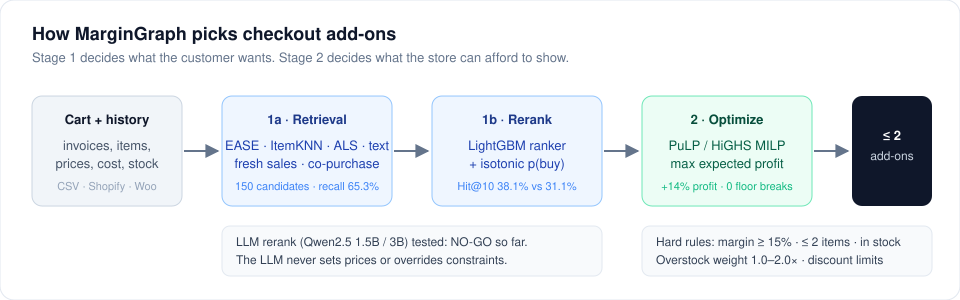
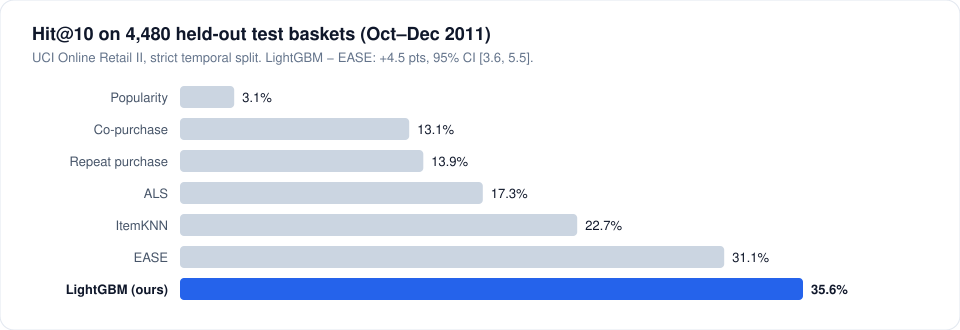
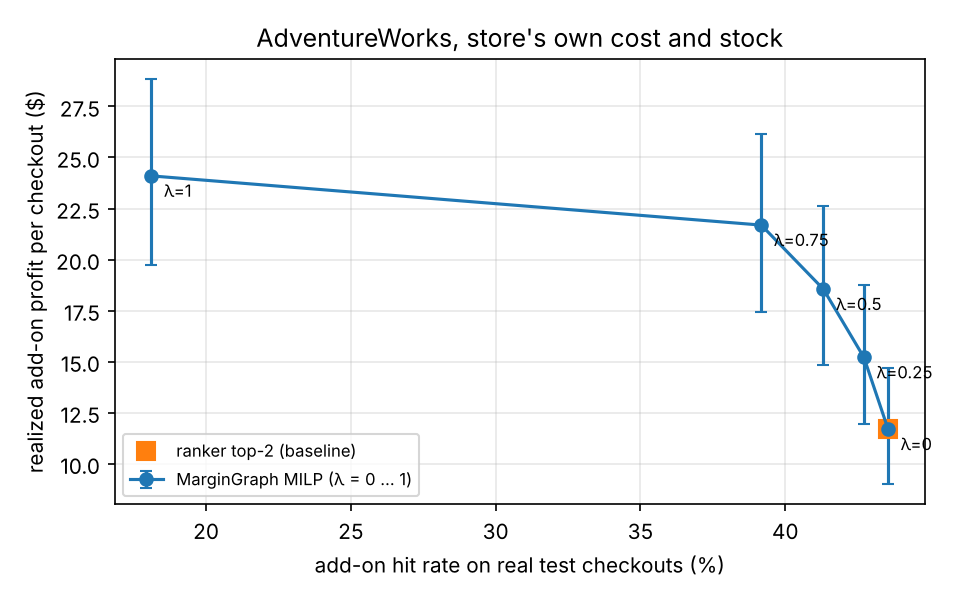

<div align="center">

<picture>
  <source media="(prefers-color-scheme: dark)" srcset="docs/assets/logo-dark.svg">
  
</picture>

**Margin-aware e-commerce recommendations: a ranker for relevance, an optimizer for profit.**

[](pyproject.toml)
[](LICENSE)
[](https://github.com/Sanskar1724/MarginGraph/actions/workflows/ci.yml)
[](src/margingraph/rerank.py)
[](src/margingraph/optimize.py)
[](src/margingraph/api.py)
[](https://huggingface.co/spaces/EquilStable/MarginGraph)
[](paper/main.pdf)

[Report](docs/PROJECT_REPORT.md) · [Results](docs/RESULTS.md) · [Other datasets](docs/RESULTS_PUBLIC.md) · [Paper](paper/main.pdf) · [Roadmap](docs/ROADMAP.md) · [Industry plan](docs/industry-plan/README.md) · [How to run](docs/RUNNING.md) · [Work log](docs/WORKLOG.md)

</div>

MarginGraph recommends add-on products that customers are likely to buy **and** that keep the retailer profitable. Stage 1 finds relevant products. Stage 2 uses mathematical optimization to choose which ones to show, under hard business rules (a 15% margin floor, at most 2 add-ons, discount limits, overstock priority).

> **Status: working research prototype, tested offline on five real retail datasets and in a 30-day store simulation.** Every number below comes from an experiment in this repo. Cost and stock are simulated except where marked; one run uses a sample company's own cost and stock (AdventureWorks). Profit numbers stay estimates until a real store's data is used.

<p align="center"></p>

## Key findings

1. **The ranker generalizes beyond one store.** The unchanged pipeline beat the best simple method on 4 of 5 datasets (UCI, Ta Feng, Dunnhumby, and Instacart once past purchases enter the shortlist first) and tied on the fifth (Olist, only 169 test baskets).
2. **The optimizer earns more and never breaks the margin rule.** In a 30-day replay of 4,480 real checkouts: **+24%** add-on profit over the ranker alone (+19% averaged over 5 random seeds), with **0** offers under the 15% floor vs **164** for the ranker. Customers accepted slightly fewer add-ons (7.5% vs 8.9%), but each earned more.
3. **The shortlist matters as much as the ranker.** Instacart's only loss came from past purchases being cut from the 150-item pool, not from the ranker. Filling the pool with the customer's own past items first turned −3.0 pts into +4.1 pts.
4. **A fixed 15% item floor is too strict for low-margin grocers.** With Ta Feng's own cost field, only 76% of products clear it and the hit rate halves; a bundle-level floor gave +38% profit. The floor should be set per store.
5. **The profit gain holds on a store's own cost and stock.** On Microsoft's AdventureWorks sample bike shop (its own cost, price and stock for every product, 27,659 online orders), the optimizer at λ=0.5 earned **+59%** add-on profit per checkout over the ranker alone, for −2.2 pts hit rate and 0 floor breaks. No free dataset from a *real* shop has both baskets and per-item cost, so this is a sample company, not a real store.
6. **The LLM does not rank.** Zero-shot (1.5B, 3B), stacked and LoRA fine-tuned LLMs all lost to LightGBM. The LLM's role is limited to cold-start products and plain-language explanations.

## Technical paper

**[MarginGraph: Margin-Aware, Constrained Recommendation of Checkout Add-Ons](paper/main.pdf)**
*Evidence from five public retail datasets and a 30-day store simulation, with a negative result for small LLM rerankers.*
Sanskar Chandawar, MIT Academy of Engineering, Pune. Preprint, 19 pages.

📄 [Read the paper (PDF)](paper/main.pdf) · [Download PDF](https://github.com/Sanskar1724/MarginGraph/raw/main/paper/main.pdf) · [Markdown version](paper/PAPER.md) · [LaTeX source](paper/main.tex)

## Results on Online Retail II (test: Oct–Dec 2011, 4,480 real baskets)

| | Result |
| --- | --- |
| LightGBM ranker Hit@10 | **38.1%** vs 31.1% for EASE, the best simple method (+7.0 pts, 95% CI [6.0, 8.0]); was 35.6% before the [accuracy work](docs/worklog/accuracy.md) |
| Shortlist recall | **65.3%** of hidden items reach the 150-item shortlist (was 58.0% at 100) |
| Optimizer (λ=0.5) vs ranker top 2 | **+14%** realized profit per basket, −1.1 pts Hit@2 (simulated cost and stock) |
| 15% margin-floor breaks | **0** with the optimizer |

<p align="center"></p>

## Results on four more public datasets

Same pipeline and settings, no tuning per dataset. The pass rule was fixed before running: LightGBM must beat the best simple method (picked on validation) with a 95% CI above zero on most datasets with at least 1,000 test baskets. **Result: passed.** Details: [`docs/RESULTS_PUBLIC.md`](docs/RESULTS_PUBLIC.md) · notebook: [`notebooks/multi_dataset_validation.ipynb`](notebooks/multi_dataset_validation.ipynb)

| Dataset | Test baskets | Best simple method | LightGBM Hit@10 | Gain [95% CI] |
| --- | --- | --- | --- | --- |
| UCI Online Retail II (UK gifts, reference) | 4,480 | EASE 31.1% | 38.1% | **+7.0** [+6.0, +8.0] |
| Ta Feng (Taiwan grocery) | 14,346 | ItemKNN 14.3% | 22.6% | **+8.3** [+7.7, +8.8] |
| Dunnhumby (US supermarket) | 20,000 | repeat 19.6% | 27.4% | **+7.8** [+7.2, +8.4] |
| ↳ with past purchases first in the pool | 20,000 | repeat 19.6% | 29.4% | **+9.8** [+9.3, +10.3] |
| Instacart (US grocery delivery) | 20,000 | repeat 37.5% | 34.5% | **−3.0** [−3.6, −2.4] (official result) |
| ↳ with past purchases first in the pool | 20,000 | repeat 37.5% | 41.6% | **+4.1** [+3.7, +4.5] |
| Olist (Brazil marketplace) | 169 | EASE-decay 17.2% | 20.7% | +3.6 [−1.2, +8.9], tie (too few baskets) |
| AdventureWorks (Microsoft sample bike shop, online orders) | 3,357 | EASE 75.4% | 80.8% | **+5.4** [+4.4, +6.4] (only 130 products, so hit rates are high) |

The official gate counts the default pool, because the rule was fixed before the runs. The "past purchases first" reruns came from diagnosing the Instacart loss (pool recall 51.7% → 70.1%).

**Profit on other stores (Stage 2, λ=0.5 vs ranker top 2):**

| Dataset | Cost source | Profit per basket | Hit-rate change |
| --- | --- | --- | --- |
| Ta Feng | simulated | **+17%** | −1.0 pt |
| Dunnhumby | simulated | **+13%** (+16% with past purchases first) | −1.1 pts |
| Ta Feng | its own `ASSET` field read as cost (unverified) | +25% with a 15% item floor; **+38%** with a bundle floor | item floor halves the hit rate |
| AdventureWorks | **the store's own cost and stock** (sample company) | **+59%** ($18.55 vs $11.69 per checkout; λ=0.75: +86%, λ=1: +106%) | −2.2 pts (λ=1: hit 43.6% → 18.1%) |

AdventureWorks margins are 23–63%, so the 15% floor never binds there; the gain comes from offering bikes (~40% margin on $1,000+) a bit more often instead of only $25 accessories. In its 30-day store simulation (λ=1) MarginGraph earned $80,898 of add-on profit vs $39,240 for the ranker, with 0 floor breaks. Dataset search, shortlist and full run: [`docs/worklog/real-cost-dataset.md`](docs/worklog/real-cost-dataset.md) · notebook: [`notebooks/real_cost_adventureworks.ipynb`](notebooks/real_cost_adventureworks.ipynb) · executed run: [`results/public/adventureworks_real_cost/real_cost_adventureworks_executed.md`](results/public/adventureworks_real_cost/real_cost_adventureworks_executed.md)

<p align="center"></p>

## 30-day store simulation

[`src/margingraph/sim.py`](src/margingraph/sim.py) replays the 4,480 real UCI test checkouts in time order as 30 store days, with stock that runs down, weekly restocks and up to 2 add-ons per checkout. Cost and stock are **simulated**, so this shows how the system behaves, not real-store profit. Log: [`docs/worklog/retail-sim.md`](docs/worklog/retail-sim.md) · executed notebook: [`results/retail_sim/retail_sim_executed.md`](results/retail_sim/retail_sim_executed.md)

| Policy | Add-on profit (replay) | 5 random seeds (mean ± sd) | Accept rate | Offers under 15% margin |
| --- | --- | --- | --- | --- |
| Ranker top 2 (no optimizer) | £920 | £842 ± 55 | 8.9% | 164 |
| MarginGraph, item floor | **£1,141 (+24%)** | £1,004 ± 60 (+19%) | 7.5% | **0** |
| MarginGraph, bundle floor | £1,145 (+24%) | £1,005 ± 61 (+19%) | 7.5% | 21 (bundle still ≥ 15%) |
| MarginGraph, overstock weight 2 | £1,099 (+19%) | £985 ± 57 (+17%) | 7.3% | 0 |

With overstock weight 2, MarginGraph sold as much overstock as the ranker (116 vs 114 units) and kept most of the profit gain.

## LLM decision

| Test | Hit@5 | vs LightGBM 27.6% |
| --- | --- | --- |
| Qwen2.5 1.5B / 3B zero-shot rerank, and as a stacker feature | 16.8% (best) | NO-GO |
| Qwen2.5 1.5B LoRA fine-tune | 7.8% (below random order) | NO-GO |

**LightGBM ranks.** The LLM is kept only for products with no purchase history (7.1% of test targets, which no co-purchase model can rank) and for one-line "why this add-on" explanations. Neither use has been measured yet. Details: [`docs/RESULTS.md`](docs/RESULTS.md).

---

## Why

Most recommenders optimize for clicks or conversion and ignore economics. A relevant item can still be a bad recommendation for the retailer if it has a thin margin, needs a deep discount, or adds to stock that is already low. MarginGraph adds explicit profit, margin and inventory logic on top of relevance, and keeps every financial decision in deterministic code.

## Architecture

<details><summary>Text version of the diagram</summary>

```text
Customer history / cart
        │
        ▼
Stage 1a: Candidate retrieval   (EASE, ItemKNN, ALS, text, fresh sales, repeat, co-purchase, popularity)
        │  up to 150 candidates
        ▼
Stage 1b: Reranker              (LightGBM; LLM tested as ranker: NO-GO)
        │  relevance score → calibrated purchase probability p(accept)
        ▼
Stage 2: PuLP optimizer         (maximize expected profit under business constraints)
        │
        ▼
Up to 2 margin-safe add-ons
```

</details>

**Stage 2 objective**

```text
maximize   Σ_i  (P_i·(1 − d) − C_i) · p_accept_i · w_i · x_i

subject to Σ_i x_i ≤ 2                         (max add-ons)
           post-discount margin ≥ 15%          (margin floor)
           x_i ∈ {0, 1}
```

`P` = price, `C` = cost, `d` = discount, `p_accept` = calibrated purchase probability from Stage 1, `w` = overstock weight (1.0–2.0), `x` = select or not.

**Design rules**

- LightGBM ranks products. The LLM is limited to cold-start items and explanations; it never ranks, sets prices or overrides constraints.
- Purchase probability comes from the relevance model, so the optimizer cannot push irrelevant high-margin items.
- Business rules are enforced by deterministic code and re-checked on every output.
- The margin floor is a per-store setting (item or bundle level): on thin-margin grocery data a fixed 15% item floor removes too many products.

## Data

| Dataset | Role |
| --- | --- |
| [UCI Online Retail II](https://archive.ics.uci.edu/dataset/502/online+retail+ii) | Primary: real invoices (baskets), real prices, product descriptions |
| [Ta Feng](https://github.com/RecoHut-Datasets/tafeng), Dunnhumby *The Complete Journey*, Instacart, [Olist](https://github.com/olist/work-at-olist-data) | Validation on four more stores: grocery, supermarket, delivery app, marketplace ([results](docs/RESULTS_PUBLIC.md)) |
| [AdventureWorks](https://github.com/microsoft/sql-server-samples/releases/tag/adventureworks) (Microsoft sample) | Stage 2 on a store's own cost, price and stock: bike shop online orders ([results](docs/worklog/real-cost-dataset.md)) |
| Simulated ERP fields | Cost, stock level and overstock flags where real data is unavailable; always labelled as simulated |
| Your own store | `margingraph sync csv / shopify / woocommerce` loads a store's products, orders, cost and stock; see [docs/CONNECTORS.md](docs/CONNECTORS.md) |

## Evaluation

| Area | Metrics |
| --- | --- |
| Relevance | Hit@5, MRR@5, Recall@10, candidate Recall@50, invalid-output rate |
| Economics | Expected profit per session, net margin, profit vs relevance trade-off |
| Inventory | Units cleared and sessions to clear (sequential stock simulation) |
| Reliability | Margin-floor violations, solver failures, latency |
| Statistics | Paired bootstrap 95% CIs over sessions, chance level reported with every metric |

## Roadmap

**Stage 1**

- [x] Data signal audit (co-purchase lift vs a shuffled null)
- [x] Strict temporal train / validation / test split
- [x] Baseline ladder: popularity, repeat purchase, co-purchase, ALS, ItemKNN, EASE
- [x] Candidate recall (pool of 150 with text, fresh-sales, customer and time-decayed EASE sources: 65.3%)
- [x] LightGBM reranker beats the best baseline
- [x] Zero-shot LLM rerank (1.5B, 3B) and LLM stacker: NO-GO
- [x] LoRA fine-tuned LLM (E6): NO-GO, LightGBM stays the ranker
- [x] Validation on four public datasets: gate passed (Ta Feng, Dunnhumby win; Instacart wins with past purchases first; Olist tie)
- [ ] Make "past purchases first" the default pool order and confirm it does not hurt UCI

**Stage 2**

- [x] Calibrate p(accept)
- [x] Strategy comparison across discounts and overstock weights
- [x] Sequential inventory simulation
- [x] Sensitivity to simulated ERP assumptions
- [x] 30-day store simulation: +24% add-on profit, 0 margin-floor breaks (simulated cost)
- [x] Run on a store's own cost and stock (AdventureWorks sample): +59% add-on profit at λ=0.5, −2.2 pts hit
- [ ] Per-store or bundle-level margin floor as the default for low-margin stores

**Production and pilot**

- [x] FastAPI demo service
- [x] Production service: multi-store API, fallbacks, auth, A/B logging, nightly retraining, Docker ([`docs/SERVICE.md`](docs/SERVICE.md))
- [x] Gradio demo for Hugging Face Spaces, live at [EquilStable/MarginGraph](https://huggingface.co/spaces/EquilStable/MarginGraph)
- [x] CSV / Shopify / WooCommerce connector (tested on UCI via CSV; no live store yet)
- [x] Merchant dashboard (policy settings, KPIs, A/B results with CIs)
- [ ] Pilot store with real cost and stock, then an A/B test

Full plan: [`docs/ROADMAP.md`](docs/ROADMAP.md). Step-by-step plan to an industry-ready product (more datasets, real store data, A/B test, hardening, free hosting): [`docs/industry-plan/`](docs/industry-plan/README.md)

## Repository layout

```text
MarginGraph/
├── src/margingraph/        Python package and `margingraph` CLI (module map in its README)
│   ├── connectors/         store sync: CSV/Excel, Shopify, WooCommerce
│   └── dashboard/          merchant dashboard (FastAPI + SQLite)
├── tests/                  pytest suite on a small synthetic fixture
├── configs/                default.yaml: split dates, pool sizes, margin floor, simulated ERP
├── results/                raw experiment outputs, E1–E11
│   ├── public/             Ta Feng, Dunnhumby, Instacart, Olist, AdventureWorks (own cost) runs
│   └── retail_sim/         30-day store simulation ledger and summary
├── notebooks/              full run, multi-dataset, store simulation and LLM notebooks
│   └── exploration/        early V1/V2 prototypes (history only, not results)
├── space/                  Hugging Face Space demo (Gradio)
├── paper/                  research paper: LaTeX, PDF, Markdown copy, figures
├── docs/                   report, results, roadmap, guides, work log, deck, launch kit
│   └── assets/             SVG diagrams
└── .github/                PR template, workflows
```

## Branches

`main` holds the full, integrated project. Each module also has its own branch with only that module's files and its own README:

| Code | Docs and tooling |
| --- | --- |
| [`feat/core-pipeline`](../../tree/feat/core-pipeline) · [`feat/ranker-accuracy`](../../tree/feat/ranker-accuracy) · [`feat/llm-reranker`](../../tree/feat/llm-reranker) · [`feat/api-service`](../../tree/feat/api-service) · [`feat/store-connectors`](../../tree/feat/store-connectors) · [`feat/merchant-dashboard`](../../tree/feat/merchant-dashboard) · [`feat/hf-space-demo`](../../tree/feat/hf-space-demo) · [`feat/multi-dataset`](../../tree/feat/multi-dataset) | [`docs/project-report`](../../tree/docs/project-report) · [`docs/research-paper`](../../tree/docs/research-paper) · [`docs/pitch-deck`](../../tree/docs/pitch-deck) · [`docs/launch-kit`](../../tree/docs/launch-kit) · [`docs/industry-roadmap`](../../tree/docs/industry-roadmap) · [`ci/github-actions`](../../tree/ci/github-actions) |

Workflow and what each branch contains: [CONTRIBUTING.md](CONTRIBUTING.md).

## Production service

A multi-store API a shop can call at checkout: per-store margin floor and overstock weights, live stock from order webhooks, a nightly retrain with a quality gate and rollback, margin-safe fallback, built-in A/B logging, API keys, metrics, Docker. SQLite and an in-memory cache by default; Postgres and Redis when you need several copies.

```bash
pip install -e ".[service]"
margingraph bootstrap-demo --store demo   # Online Retail II as a store: import + train, ~2 min, < 2 GB RAM
margingraph api                           # http://localhost:8000/docs
```

On 1,031 real held-back orders replayed through the API: p50 about 65 ms, p95 about 90 ms, 0 errors. The margin-aware policy cut add-on conversion (significant at λ = 1) and its profit gain was not significant at that sample size, so stores should run the built-in A/B test. Design and results: [`docs/SERVICE.md`](docs/SERVICE.md). Contract: [`docs/API.md`](docs/API.md).

## Merchant dashboard

A store owner sets the margin floor, overstock weights and excluded products, and sees profit uplift, margin, overstock cleared, clicks, buys and A/B results with 95% CIs. It is FastAPI with plain HTML and SQLite, and uses about 190 MB of RAM.

```bash
margingraph dashboard --sample   # demo store on http://127.0.0.1:8501 (sample data is simulated and labelled)
```

Guide and integration contract: [`docs/DASHBOARD.md`](docs/DASHBOARD.md).

## Setup (free)

Everything runs on free tools: a laptop or Colab CPU for data prep, baselines and the optimizer; Kaggle Notebooks or a free Colab T4 GPU for the LLM steps; Parquet + DuckDB instead of a database.

```bash
pip install -e ".[dev]"
margingraph prepare && margingraph run   # full pipeline on CPU
margingraph serve                         # API on :8000
```

Details in [`docs/RUNNING.md`](docs/RUNNING.md).

**Secrets:** never put keys in notebooks. In Colab, add `HF_TOKEN`, `KAGGLE_USERNAME` and `KAGGLE_KEY` under *Secrets*, then:

```python
from google.colab import userdata
HF_TOKEN = userdata.get("HF_TOKEN")
```

## Tech stack

`Python` · `pandas` · `DuckDB` · `LightGBM` · `implicit` · `PuLP (CBC or HiGHS)` · `FastAPI` · `SQLAlchemy (SQLite / Postgres)` · `Redis (optional)` · `Docker` · `Qwen2.5 (tested on Kaggle; cold-start and explanations only)` · `Colab / Kaggle`

## License

[MIT](LICENSE)

---

**MarginGraph: let the model understand the customer, and let optimization protect the margin.**
