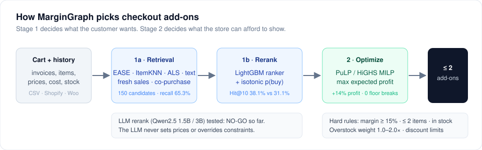
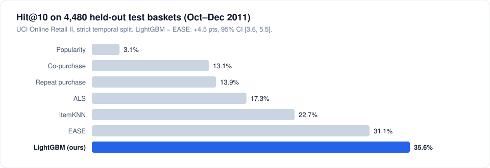

<div align="center">

# MarginGraph

**Margin-aware e-commerce recommendations: a ranker for relevance, an optimizer for profit.**

[](pyproject.toml)
[](LICENSE)
[](tests/)
[](src/margingraph/rerank.py)
[](src/margingraph/optimize.py)
[](src/margingraph/api.py)
[](space/)
[](paper/main.pdf)

[Report](docs/PROJECT_REPORT.md) · [Results](docs/RESULTS.md) · [Paper](paper/main.pdf) · [Roadmap](docs/ROADMAP.md) · [How to run](docs/RUNNING.md) · [Work log](docs/WORKLOG.md)

</div>

MarginGraph recommends add-on products that customers are likely to buy **and** that keep the retailer profitable. Stage 1 finds relevant products. Stage 2 uses mathematical optimization to choose which ones to show, under hard business rules (a 15% margin floor, at most 2 add-ons, discount limits, overstock priority).

> **Status: working research prototype, tested offline on real data.** Every number below comes from an experiment in this repo. Cost and stock are simulated, so profit numbers are estimates until a real store's data is used.

<p align="center"></p>

## Results so far (test: Oct–Dec 2011, 4,480 real baskets)

| | Result |
| --- | --- |
| LightGBM ranker Hit@10 | **38.1%** vs 31.1% for EASE, the best simple method (+7.0 pts, 95% CI [6.0, 8.0]); was 35.6% before the [accuracy work](docs/worklog/accuracy.md) |
| Shortlist recall | **65.3%** of hidden items reach the 150-item shortlist (was 58.0% at 100) |
| Optimizer (λ=0.5) vs ranker top 2 | **+14%** realized profit per basket, −1.1 pts Hit@2 (simulated cost and stock) |
| 15% margin-floor breaks | **0** with the optimizer |
| LLM as ranker (Qwen2.5 1.5B / 3B zero-shot, and as a stacker feature) | **NO-GO**: Hit@5 16.8% vs 27.6% for LightGBM. LoRA fine-tune is next |

<p align="center"></p>

---

## Why

Most recommenders optimize for clicks or conversion and ignore economics. A relevant item can still be a bad recommendation for the retailer if it has a thin margin, needs a deep discount, or adds to stock that is already low. MarginGraph adds explicit profit, margin and inventory logic on top of relevance, without letting a language model make financial decisions.

## Architecture

<details><summary>Text version of the diagram</summary>

```text
Customer history / cart
        │
        ▼
Stage 1a: Candidate retrieval   (EASE, ItemKNN, ALS, repeat purchase, co-purchase, popularity)
        │  up to 100 candidates
        ▼
Stage 1b: Reranker              (LightGBM; LLM tested, NO-GO so far)
        │  relevance score → calibrated purchase probability p(accept)
        ▼
Stage 2: PuLP optimizer         (maximize expected profit under business constraints)
        │
        ▼
Up to 2 margin-safe add-ons
```

</details>

**Stage 2 objective**

```text
maximize   Σ_i  (P_i·(1 − d) − C_i) · p_accept_i · w_i · x_i

subject to Σ_i x_i ≤ 2                         (max add-ons)
           post-discount margin ≥ 15%          (margin floor)
           x_i ∈ {0, 1}
```

`P` = price, `C` = cost, `d` = discount, `p_accept` = calibrated purchase probability from Stage 1, `w` = overstock weight (1.0–2.0), `x` = select or not.

**Design rules**

- The LLM ranks products; it never sets prices or overrides constraints.
- Purchase probability comes from the relevance model, so the optimizer cannot push irrelevant high-margin items.
- Business rules are enforced by deterministic code and re-checked on every output.

## Data

| Dataset | Role |
| --- | --- |
| [UCI Online Retail II](https://archive.ics.uci.edu/dataset/502/online+retail+ii) | Primary: real invoices (baskets), real prices, product descriptions |
| H&M Personalized Fashion (Kaggle) | Scale-up option with richer product text |
| Simulated ERP fields | Cost, stock level and overstock flags where real data is unavailable; always labelled as simulated |
| Your own store | `margingraph sync csv / shopify / woocommerce` loads a store's products, orders, cost and stock; see [docs/CONNECTORS.md](docs/CONNECTORS.md) |

## Evaluation

| Area | Metrics |
| --- | --- |
| Relevance | Hit@5, MRR@5, Recall@10, candidate Recall@50, invalid-output rate |
| Economics | Expected profit per session, net margin, profit vs relevance trade-off |
| Inventory | Units cleared and sessions to clear (sequential stock simulation) |
| Reliability | Margin-floor violations, solver failures, latency |
| Statistics | Paired bootstrap 95% CIs over sessions, chance level reported with every metric |

## Roadmap

**Stage 1**

- [x] Data signal audit (co-purchase lift vs a shuffled null)
- [x] Strict temporal train / validation / test split
- [x] Baseline ladder: popularity, repeat purchase, co-purchase, ALS, ItemKNN, EASE
- [x] Candidate recall (pool of 150 with text, fresh-sales, customer and time-decayed EASE sources: 65.3%)
- [x] LightGBM reranker beats the best baseline
- [x] Zero-shot LLM rerank (1.5B, 3B) and LLM stacker: NO-GO
- [ ] LoRA fine-tuned LLM (E6, notebook ready)

**Stage 2**

- [x] Calibrate p(accept)
- [x] Strategy comparison across discounts and overstock weights
- [x] Sequential inventory simulation
- [x] Sensitivity to simulated ERP assumptions

**Production and pilot**

- [x] FastAPI demo service
- [ ] Production API with fallback, logging and auth
- [x] Gradio demo for Hugging Face Spaces (built; deploy steps in [`space/DEPLOY.md`](space/DEPLOY.md))
- [x] CSV / Shopify / WooCommerce connector (tested on UCI via CSV; no live store yet)
- [x] Merchant dashboard (policy settings, KPIs, A/B results with CIs)
- [ ] Pilot store with real cost and stock, then an A/B test

Full plan: [`docs/ROADMAP.md`](docs/ROADMAP.md)

## Repository layout

```text
MarginGraph/
├── src/margingraph/        Python package and `margingraph` CLI (module map in its README)
│   ├── connectors/         store sync: CSV/Excel, Shopify, WooCommerce
│   └── dashboard/          merchant dashboard (FastAPI + SQLite)
├── tests/                  pytest suite on a small synthetic fixture
├── configs/                default.yaml: split dates, pool sizes, margin floor, simulated ERP
├── results/                raw experiment outputs, E1–E11
├── notebooks/              full run and LLM notebooks for free Kaggle / Colab GPUs
│   └── exploration/        early V1/V2 prototypes (history only, not results)
├── space/                  Hugging Face Space demo (Gradio)
├── paper/                  arXiv-style paper: LaTeX, PDF, figures
├── docs/                   report, results, roadmap, guides, work log, deck, launch kit
│   └── assets/             SVG diagrams
└── .github/                PR template, workflows
```

## Branches

`main` holds the full, integrated project. Each module also has its own branch for focused development (`feat/core-pipeline`, `feat/store-connectors`, `feat/merchant-dashboard`, `feat/hf-space-demo`, `docs/research-paper`, …). The full list and the workflow are in [CONTRIBUTING.md](CONTRIBUTING.md).

## Merchant dashboard

A store owner sets the margin floor, overstock weights and excluded products, and sees profit uplift, margin, overstock cleared, clicks, buys and A/B results with 95% CIs. It is FastAPI with plain HTML and SQLite, and uses about 190 MB of RAM.

```bash
margingraph dashboard --sample   # demo store on http://127.0.0.1:8501 (sample data is simulated and labelled)
```

Guide and integration contract: [`docs/DASHBOARD.md`](docs/DASHBOARD.md).

## Setup (free)

Everything runs on free tools: a laptop or Colab CPU for data prep, baselines and the optimizer; Kaggle Notebooks or a free Colab T4 GPU for the LLM steps; Parquet + DuckDB instead of a database.

```bash
pip install -e ".[dev]"
margingraph prepare && margingraph run   # full pipeline on CPU
margingraph serve                         # API on :8000
```

Details in [`docs/RUNNING.md`](docs/RUNNING.md).

**Secrets:** never put keys in notebooks. In Colab, add `HF_TOKEN`, `KAGGLE_USERNAME` and `KAGGLE_KEY` under *Secrets*, then:

```python
from google.colab import userdata
HF_TOKEN = userdata.get("HF_TOKEN")
```

## Tech stack

`Python` · `pandas` · `DuckDB` · `LightGBM` · `implicit` · `PuLP (CBC or HiGHS)` · `FastAPI` · `Qwen2.5 (tested on Kaggle)` · `Colab / Kaggle`

## License

[MIT](LICENSE)

---

**MarginGraph: let the model understand the customer, and let optimization protect the margin.**
