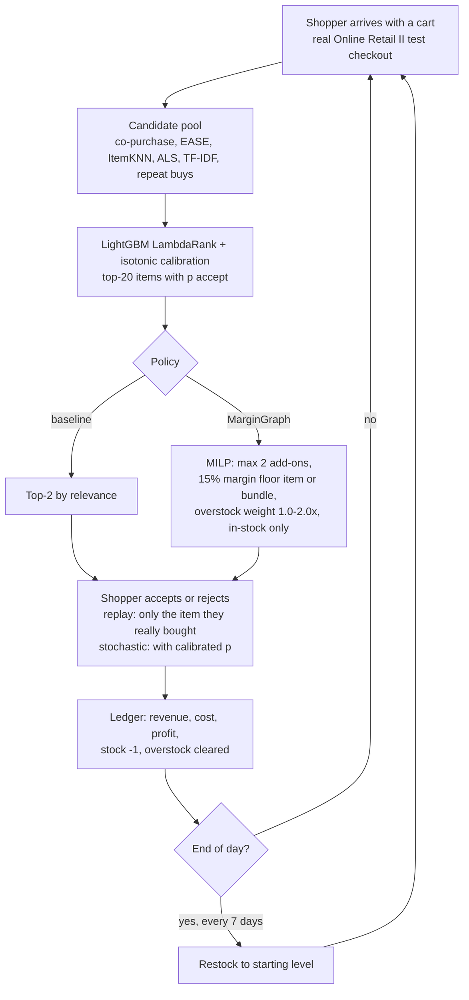

# Retail simulation environment (2026-10-31)

Goal: show how MarginGraph behaves inside a store, day by day, since no real store cost/stock data is available.

## Flow



## How to run

```bash
margingraph prepare && margingraph run          # real pipeline, writes artifacts/test_slates.parquet + results/erp_simulated.csv
python -m margingraph.sim --days 30 --seeds 5    # writes results/retail_sim/{daily_ledger,summary}.csv
```

Code: `src/margingraph/sim.py`. Policies: `ranker_top2`, `margingraph_item_floor`, `margingraph_bundle_floor`, `margingraph_overstock_w2`.

## Assumptions (be honest about these)
- Cost, stock and overstock are SIMULATED (`data.simulate_erp`, margin ~ Beta(4,6)).
- 30 "days" = test checkouts in time order cut into 30 equal chunks.
- Restock every 7 days back to the starting level.
- Stochastic acceptance trusts the calibrated LightGBM probability.

## Status
- Simulator written and checked on synthetic data. The full pipeline run in the container was started but the session was stopped after ~8 minutes by request (credit), so no real-data results are committed yet. Next step: run the two commands above and add `notebooks/retail_sim.ipynb` with outputs.
