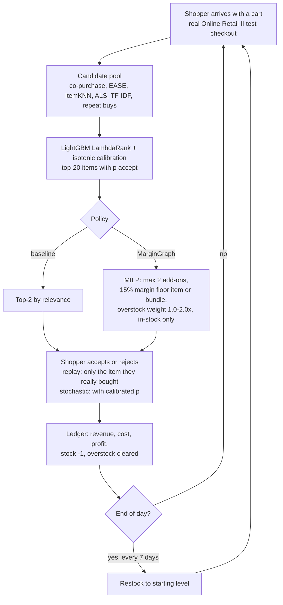

# Retail simulation environment (2026-10-31)

Goal: show how MarginGraph behaves inside a store, day by day, since no real store cost/stock data is available.

## Flow



## How to run

```bash
margingraph prepare && margingraph run          # real pipeline, writes artifacts/test_slates.parquet + results/erp_simulated.csv
python -m margingraph.sim --days 30 --seeds 5    # writes results/retail_sim/{daily_ledger,summary}.csv
```

Code: `src/margingraph/sim.py`. Policies: `ranker_top2`, `margingraph_item_floor`, `margingraph_bundle_floor`, `margingraph_overstock_w2`.

## Assumptions (be honest about these)
- Cost, stock and overstock are SIMULATED (`data.simulate_erp`, margin ~ Beta(4,6)).
- 30 "days" = test checkouts in time order cut into 30 equal chunks.
- Restock every 7 days back to the starting level.
- Stochastic acceptance trusts the calibrated LightGBM probability.

## Results (run 2026-10-31 in the cloud container, real pipeline, SIMULATED cost/stock)

4,480 real test checkouts (2011-10-02 to 2011-12-09) replayed as 30 days; up to 2 add-ons each (8,959 offers per policy).

| Policy | Profit (replay) | vs ranker | Profit (stochastic, mean of 5 seeds ± sd) | Accept rate | Add-on margin | Overstock units sold | Offers under 15% margin |
|---|---|---|---|---|---|---|---|
| ranker_top2 (baseline) | £920 | – | £842 ± 55 | 8.9% | 40.3% | 114 | 164 |
| MarginGraph, item floor | £1,141 | **+24%** | £1,004 ± 60 (+19%) | 7.5% | 44.5% | 78 | 0 |
| MarginGraph, bundle floor | £1,145 | +24% | £1,005 ± 61 (+19%) | 7.5% | 44.2% | 79 | 21 (bundle still ≥15%) |
| MarginGraph, overstock w=2 | £1,099 | +19% | £985 ± 57 (+17%) | 7.3% | 44.3% | 116 | 0 |

Reading: MarginGraph accepts fewer add-ons (7.5% vs 8.9%) but each one earns more, so add-on profit rises ~19-24% and no offer breaks the margin floor (the ranker breaks it 164 times). The 2x overstock weight clears as much overstock as the ranker (116 vs 114 units) while keeping most of the profit gain. Stockouts blocked 223 top-2 slots for every policy. These are simulated-cost numbers: they show how the system behaves, not real-store profit.

Files: `results/retail_sim/summary.csv`, `results/retail_sim/daily_ledger.csv`, `results/retail_sim/retail_sim_executed.md` (notebook with outputs), `notebooks/retail_sim.ipynb` (committed cleared, per repo hook).

Run log: `margingraph prepare` + `margingraph run` 11:37-~11:55 UTC on 4 CPU cores; simulation itself takes under a minute.
