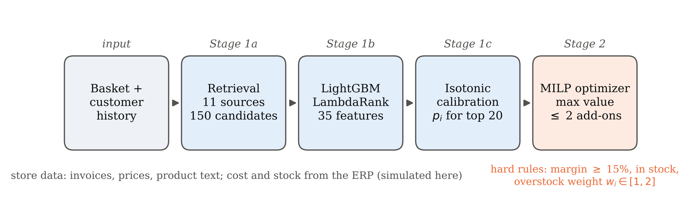
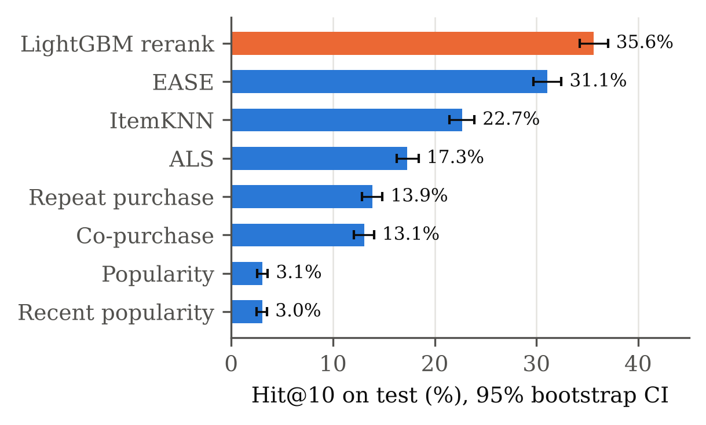
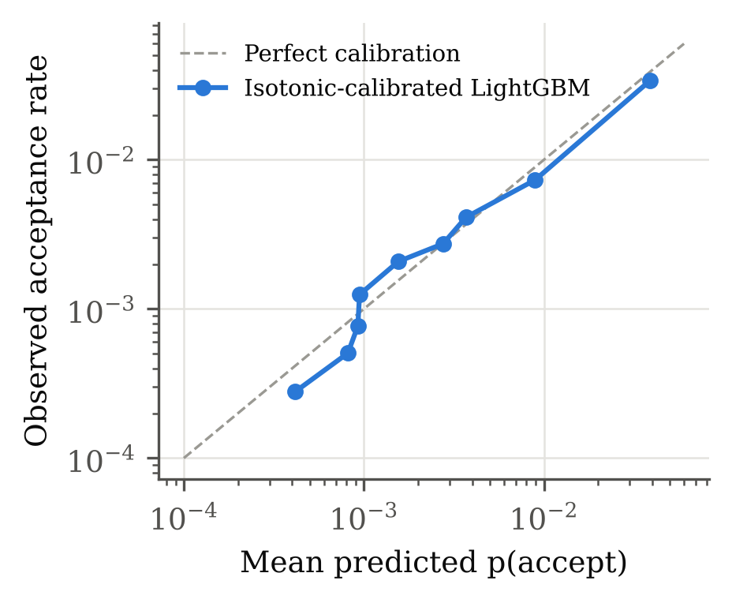
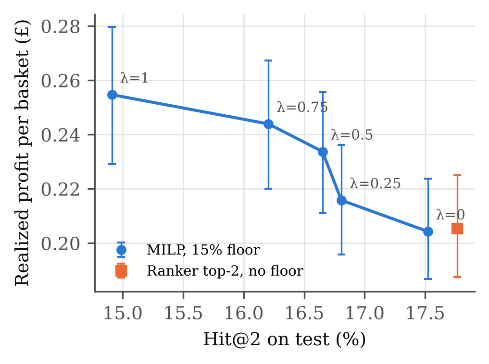
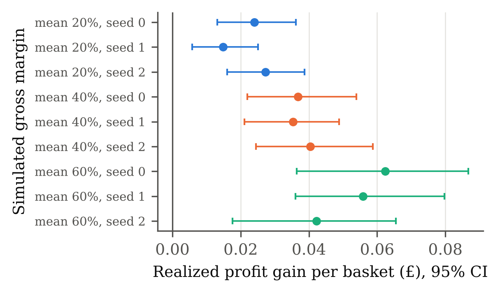
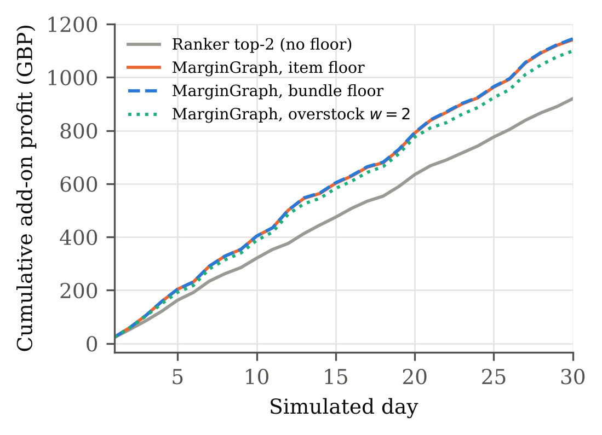
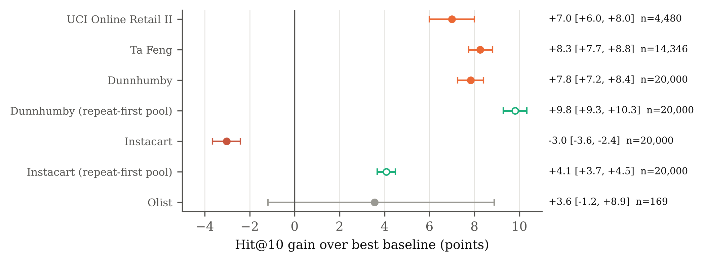
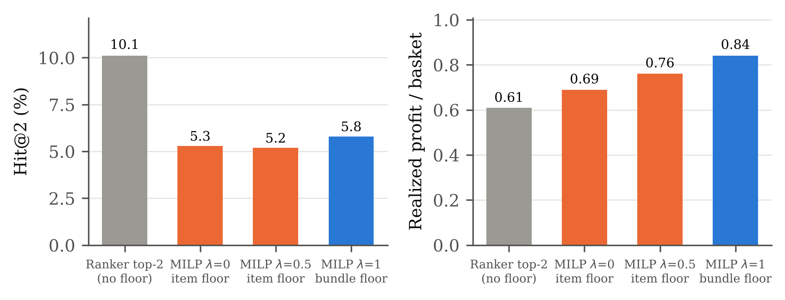
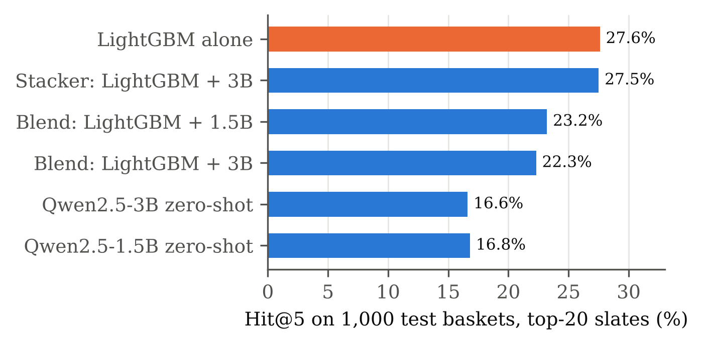

# MarginGraph: Margin-Aware, Constrained Recommendation of Checkout Add-Ons

*Evidence from five public retail datasets and a 30-day store simulation, with a negative result for small LLM rerankers*

**Sanskar Chandawar** · [Department, College / University, City, Country] · [e-mail] · [github.com/Sanskar1724/MarginGraph](https://github.com/Sanskar1724/MarginGraph)

Preprint, 31 October 2026

> This Markdown copy is generated from `paper/main.tex` with pandoc (see `paper/README.md`). The PDF (`paper/main.pdf`) is the reference version. Text in [square brackets] in the author line is a placeholder for the author to fill in.

## Abstract

Recommenders in retail are usually trained to predict what a shopper will buy, while the store is paid by what it earns. We study this gap for a narrow, common decision: which (at most two) add-on products to suggest at checkout. MarginGraph is a two-stage system. Stage 1 retrieves 150 candidates from eleven sources and reranks them with a calibrated LightGBM LambdaRank model. Stage 2 solves a small mixed-integer program per basket that trades expected relevance against expected gross profit under a hard 15% margin floor, a two-item limit, stock availability and an optional overstock weight. On a strict temporal split of UCI Online Retail II (4,480 test baskets) the reranker reaches Hit@10 of 38.1%, 7.0 points above the best baseline (EASE; paired 95% CI [6.0, 8.0]). Against a success criterion fixed before running, the same pipeline, unchanged, beats the best validation-selected baseline on Ta Feng (+8.3 [7.7, 8.8], 14,346 baskets) and Dunnhumby (+7.8 [7.2, 8.4]), ties on Olist (169 baskets), and loses on Instacart (−3.0 [−3.6, −2.4]). We trace the Instacart loss to the order in which the candidate pool is filled: putting the customer’s past purchases first raises pool recall from 51.7% to 70.1% and turns the loss into a gain of +4.1 [3.7, 4.5] (Dunnhumby: +9.8 [9.3, 10.3]). With *simulated* unit cost and stock, the optimizer raises gross profit per basket by 13–17% over the ranker’s top-2 on three datasets for about one point of hit rate, and in a 30-day replay of real UCI checkouts it earns £1,141 of add-on profit against £920 (+24%; +19% under stochastic acceptance over five seeds) with zero margin-floor violations against 164. On Ta Feng, with the dataset’s own `ASSET` field read as unit cost, a fixed 15% item floor halves the hit rate, which argues for store-specific or bundle-level floors. Finally, zero-shot and LoRA-tuned Qwen2.5 rerankers (1.5B and 3B) do not beat LightGBM. Every number is read from files the pipeline writes; none are targets.

## 1. Introduction

A checkout add-on is a small, high-volume decision. The shopper has already chosen a basket; the store may show one or two more products. Showing the product the shopper is most likely to add maximises conversions, but that product may carry a thin margin, may be out of stock, or may compete with stock the store needs to clear. Price- and profit-aware recommendation is a long-standing topic (Jannach and Adomavicius 2017; Abdollahpouri et al. 2020), yet most open recommender benchmarks report only accuracy, and many published accuracy gains do not survive strong, well-tuned baselines (Ferrari Dacrema, Cremonesi, and Jannach 2019).

This paper makes five contributions.

1.  **A leakage-free checkout add-on benchmark** on UCI Online Retail II (Chen 2019): one product hidden per invoice, one global temporal cutoff per split, and full-catalog ranking (no sampled negatives (Krichene and Rendle 2020)).

2.  **A strong Stage 1**: a baseline ladder of eleven candidate sources, a 150-item candidate pool, and a calibrated LightGBM reranker, each step measured with paired bootstrap confidence intervals.

3.  **A Stage 2 optimizer** that turns calibrated probabilities into an add-on choice under hard business rules, checked against exact enumeration, evaluated by replaying real purchases, stress-tested across simulated cost scenarios, and run day by day in a 30-day store simulation.

4.  **An external-validity study** on four further public datasets (Ta Feng, Dunnhumby, Instacart, Olist) against a success criterion fixed in advance, including a failure, its diagnosis, and a one-line fix.

5.  **A documented negative result** for small open LLMs as rerankers, zero-shot, blended, stacked and LoRA-tuned, on the same slates as LightGBM.

None of the five datasets has a verified unit cost, so every profit number depends on a simulation that we state in full (Section 4.3). We treat this as the main limitation of the study rather than a footnote.

*Figure 1. MarginGraph at a glance. Stage 1 decides what the shopper is likely to add; Stage 2 decides what to show, trading relevance against profit under hard business rules that no model can override.*

**Table 1.** Main results at a glance. Hit@10: the item the shopper actually added is among the top 10 suggestions. All intervals are paired 95% bootstrap CIs. *Profit rests on simulated unit cost and stock.

| Question                                     | Answer (section)                                                                                                                                                                                                                                                  |
|:---------------------------------------------|:------------------------------------------------------------------------------------------------------------------------------------------------------------------------------------------------------------------------------------------------------------------|
| Does the reranker beat strong baselines?     | Yes on UCI: Hit@10 38.1% vs 31.1% for EASE, +7.0 [6.0, 8.0] (6.1)                                                                                                                       |
| Does it transfer to other stores?            | Ta Feng +8.3 [7.7, 8.8], Dunnhumby +7.8 [7.2, 8.4], Olist tie, Instacart −3.0 [−3.6, −2.4] (6.5)                                                                            |
| Why did Instacart lose, and can it be fixed? | Past purchases entered the pool too late; repeat-first pool: +4.1 [3.7, 4.5] (6.6)                                                                                                  |
| Does the optimizer add profit?*        | +14% (UCI), +17% (Ta Feng), +13% (Dunnhumby) per basket for ≈1 pt of Hit@2 (6.2, 6.7) |
| What happens over a month in a store?* | £1,141 vs £920 add-on profit (+24%), 0 vs 164 offers under the margin floor (6.4)                                                                                                       |
| Is a 15% floor always right?                 | No: with Ta Feng’s cost-like field, it halves Hit@2; a bundle floor works better (6.7)                                                                                        |
| Do small LLMs help ranking?                  | No: zero-shot, blended, stacked and LoRA-tuned Qwen2.5 all lose or tie (6.8)                                                                                                            |

Figure 1 shows the system and Table 1 summarises the answers this paper gives. Section 2 reviews related work, Section 3 describes the data and the task, Section 4 the method, Section 5 the experimental protocol, and Section 6 the results; Sections 7–9 discuss what transfers, the limitations, and next steps.

## 2. Related work

**Classical next-item and basket recommenders.** Item-based collaborative filtering (Sarwar et al. 2001), implicit-feedback matrix factorization (ALS) (Y. Hu, Koren, and Volinsky 2008) and the closed-form linear autoencoder EASE (Steck 2019) remain strong on sparse purchase data. Ferrari Dacrema, Cremonesi, and Jannach (2019) showed that simple, tuned neighbourhood methods often match or beat recent neural models, which is why our ladder includes them and why the reranker must beat the best of them on paired tests. Krichene and Rendle (2020) showed that sampled ranking metrics can reorder models; we therefore rank against the full catalog. In grocery next-basket recommendation, a large share of items are repeat purchases, and simple personal-frequency models are hard to beat (H. Hu et al. 2020); Li et al. (2023) show that much of the reported progress in that area comes from repeat items. Our Instacart result (Section 6.6) is a direct instance of this effect.

**Learning to rank and calibration.** We rerank with LambdaRank-style gradient boosting (Burges 2010) as implemented in LightGBM (Ke et al. 2017). Stage 2 needs probabilities, not scores, so we fit an isotonic map from score to purchase probability (Zadrozny and Elkan 2002).

**Profit-aware and multi-objective recommendation.** Jannach and Adomavicius (2017) survey price and profit awareness in recommenders, and Abdollahpouri et al. (2020) frame the store as one of several stakeholders whose utility a recommender should account for. Louca et al. (2019) jointly optimise profit and relevance in e-commerce ranking at Etsy; Pei et al. (2019) maximise expected profit with reinforcement learning at Taobao; Agarwal et al. (2011) optimise one objective under constraints on others for content recommendation. MarginGraph is closest to the constrained view: it keeps relevance in the objective and puts the store’s rules (margin floor, item limit, stock) in hard constraints, solved exactly per basket with an open-source MILP stack (Mitchell, O’Sullivan, and Dunning 2011; Huangfu and Hall 2018). Unlike the industrial studies above, every component and result here is public and reproducible on free datasets and a CPU.

**LLMs as recommenders.** Hou et al. (2024) show that LLMs can rank candidates zero-shot but are sensitive to order and history length and trail trained recommenders on several benchmarks. TALLRec (Bao et al. 2023) shows that parameter-efficient tuning (LoRA (E. J. Hu et al. 2022)) aligns an LLM with recommendation data far better than prompting. We test the cheapest version of this idea a student can run for free: Qwen2.5 (Qwen Team 2024) 1.5B and 3B on a single Kaggle T4 GPU.

## 3. Data and task

**Primary dataset.** UCI Online Retail II (Chen 2019; Chen, Sain, and Guo 2012) contains the transactions of a UK online gift and homeware wholesaler from December 2009 to December 2011. From 1,067,371 raw rows we drop cancellations and adjustments (19,500), non-positive quantity or price (6,202), non-product codes such as postage and fees (4,792), and exact duplicates (33,663), leaving 991,910 invoice lines over 39,516 invoices, 4,707 products and 5,852 known customers. The data has a unit price but no unit cost and no stock level.

**Additional datasets.** To test whether the result transfers, we ran the same pipeline on four public datasets that differ in country, sector and basket shape (Table 2). Each is converted to the same invoice-line schema and restricted to its 5,000 most-ordered products. *Ta Feng* (Ta Feng Grocery 2001) is a Taiwanese warehouse grocer; it has no basket id, so one customer on one day is one basket, and it has an `ASSET` field that we test as a unit cost (Section 6.7). *Dunnhumby* (dunnhumby 2014) is two years of a US supermarket’s household baskets; real dates are hidden, so `DAY 1` is mapped to 2018-01-01, and price is sales value over quantity after discounts. *Instacart* (Instacart 2017) is US online grocery delivery; it has no prices (so Stage 2 is not run) and no dates (we rebuild them from `days_since_prior_order`); we sample 20,000 customers, and 62% of its lines are re-buys. *Olist* (Olist 2018) is a Brazilian marketplace; 98% of its orders hold one product, so only 169 test baskets qualify.

**Table 2.** Datasets after cleaning, restricted to the 5,000 most-ordered products (UCI: full catalog). Test baskets are invoices with at least two products in the test window, capped at 20,000.

| Dataset                                                                    | Sector              |     Lines | Baskets | Customers | Test baskets | Price / cost              |
|:---------------------------------------------------------------------------|:--------------------|----------:|--------:|----------:|-------------:|:--------------------------|
| UCI Online Retail II                                                       | UK gift wholesaler  |   991,910 |  39,516 |     5,852 |        4,480 | price / –                 |
| Ta Feng                                                                    | Taiwan grocery      |   656,360 | 114,483 |    31,700 |       14,346 | price / `ASSET`† |
| Dunnhumby                                                                  | US supermarket      | 1,654,347 | 243,257 |     2,487 |       20,000 | price / –                 |
| Instacart                                                                  | US grocery delivery | 2,721,735 | 322,215 |    19,981 |       20,000 | – / –                     |
| Olist                                                                      | Brazil marketplace  |    62,626 |  61,294 |    60,000 |          169 | price / –                 |

† Undocumented field; read as unit cost in one run, not verified.

**Task.** For each evaluation invoice with 2–50 distinct products we hide one product at random; the model sees the remaining basket (and the customer’s earlier history, if known) and must rank the full catalog. The hidden product is the single relevant item. We report three standard ranking metrics. With $\mathrm{rank}_b$ the position of the hidden item in the ranked list for basket $b$ and $B$ the set of test baskets,

$$\text{Hit@}K=\frac{1}{|B|}\sum_{b\in B}\mathbb{1}[\mathrm{rank}_b\le K],\qquad \text{NDCG@10}=\frac{1}{|B|}\sum_{b\in B}\frac{\mathbb{1}[\mathrm{rank}_b\le 10]}{\log_2(\mathrm{rank}_b+1)},\qquad \text{MRR}=\frac{1}{|B|}\sum_{b\in B}\frac{1}{\mathrm{rank}_b}.$$

 Hit@10 is the headline metric: it is the share of baskets in which the product the shopper really added appears among ten suggestions. For Stage 2, where only two items are shown, we report Hit@2.

**Split.** One global cutoff per boundary, with no invoice in two splits. On UCI: train up to 2011-06-30 (709,574 lines), validation July–September 2011 (3,822 events), test 2011-10-02 to 2011-12-09 (4,480 events). Test candidates come from models refit on train+validation, which ends before the test window starts. 7.1% of UCI test targets never appear before the test window, so no model can exceed 92.9% Hit@$K$ there. The other datasets use the same split logic with cutoffs at the same relative positions.

**Signal audit (E1).** Before modelling we checked that baskets carry a learnable signal. On UCI validation, a co-purchase model fit on real baskets reaches Hit@10 of 16.1%, against 4.4% when the same model is fit on baskets whose items were shuffled across invoices, and 0.23% for chance. The highest-lift pairs are recognisable complements (matching paper cups and plates; egg cosies in two colours). The same audit on Dunnhumby gives a weaker signal (1.7× over shuffled baskets).

## 4. Method

### 4.1 Stage 1: retrieval, reranking and calibration

Stage 1 follows the retrieve-then-rerank pattern of Figure 1: cheap scorers each propose candidates, a learned model orders the union, and a calibration step turns its scores into probabilities that Stage 2 can multiply by money.

**Baselines and candidate pool.** Seven classical scorers are fit on the training period: global popularity, 90-day popularity, the customer’s repeat purchases, co-purchase counts, ItemKNN (Sarwar et al. 2001), EASE (λ=250, chosen on validation) (Steck 2019) and ALS (64 factors) (Y. Hu, Koren, and Volinsky 2008). Four further sources were added after a validation-only selection (Section 6.1): EASE on recency-weighted baskets (half-life 120 days), EASE applied to the customer’s own past items, TF-IDF similarity of product descriptions (word 1–2 and character 3–4 grams, maximum over the basket), and a *fresh* signal that, like a nightly job, sees only invoices from days before the event: 14-day trending items and co-purchase over that stream. The item index covers the whole catalog, so products first sold after the fit cutoff can be recommended once the fresh source sees them sell; a product with no earlier sales gets zero from every source. The candidate pool unions the top lists of each source in a fixed order (EASE 90, decayed EASE 60, customer EASE 30, text 30, trending 22, fresh co-purchase 30, ItemKNN 45, ALS 45, repeat 45, co-purchase 30, the two popularity scorers 15 each), deduplicated and capped at 150 items, with basket items removed. Because the cap is applied after the union, *the order of sources matters*: a source late in the list contributes only the items that still fit. Section 6.6 shows that this order, tuned on UCI, is wrong for repeat-heavy grocery data, and evaluates a *repeat-first* order that puts the customer’s past purchases (60 items) at the front.

**Reranker.** A LightGBM LambdaRank model (Ke et al. 2017; Burges 2010) (31 leaves, learning rate 0.05, up to 500 trees with early stopping) scores each candidate from 35 features: the score and rank from every source, price, price relative to the basket, item age and recency, basket size, share of basket items in the same category, and whether the customer is known. It is trained on validation events whose candidates were produced by train-only models, so the reranker never sees test-period data; each validation invoice contributes three events, each hiding a different product (early stopping and calibration use only the original one). On UCI, the most important features by gain are the decayed-EASE and EASE ranks, the repeat-purchase score and the text similarity.

**Calibration.** An isotonic regression (Zadrozny and Elkan 2002), fit on a held-out, later slice of validation events, maps the reranker score to $p_i$, the probability that candidate $i$ is the product the shopper adds.

### 4.2 Stage 2: constrained add-on selection

For a basket, take the top $N{=}20$ reranked candidates. Let $x_{i,d}\in\{0,1\}$ mean “offer item $i$ at discount $d$”, with price $r_i$, unit cost $c_i$, revenue $r_{i,d}=r_i(1-d)$ and unit profit $\pi_{i,d}=r_{i,d}-c_i$. The optimizer solves

$$\begin{aligned}
\max_{x}\;& \sum_{i,d} x_{i,d}\; p_{i,d}\,\Big[(1-\lambda)\,\bar{\pi} + \lambda\, w_i\, \pi_{i,d}\Big]\\
\text{s.t.}\;& \textstyle\sum_d x_{i,d} \le 1 \;\;\forall i, \qquad \sum_{i,d} x_{i,d} \le 2,\\
& x_{i,d}=0 \text{ if stock}_i \le 0, \qquad \pi_{i,d} \ge 0.15\, r_{i,d} \text{ whenever } x_{i,d}=1.
\end{aligned}$$

Here $\bar\pi$ is the catalog’s mean unit gross profit, which puts the relevance term on the same scale as profit, so λ=0 ranks by probability alone and λ=1 maximises overstock-weighted expected profit. $w_i\in[1,2]$ up-weights items flagged as overstock. The *bundle floor* variant replaces the per-item floor with $\sum \pi_{i,d} x_{i,d} \ge 0.15 \sum r_{i,d} x_{i,d}$, so one thin-margin item can be offered if its partner carries it. Discounts use an *assumed* response $p_{i,d}=\min(1,\,p_i(1+1.5d))$ for $d\in\{0,0.1,0.2\}$; this elasticity is not estimated from data. The program is built in PuLP (Mitchell, O’Sullivan, and Dunning 2011) and solved with HiGHS (Huangfu and Hall 2018); because at most two items are chosen, exact enumeration of all singles and pairs gives the same optimum and is used for the bulk offline sweeps.

**Illustrative example (hypothetical numbers).** Suppose the reranker gives candidate A a probability of 10% at a price of £2.00 and a 10% margin, and candidate B 8% at £3.00 and a 45% margin. A plain ranker shows A first. At λ=1 the optimizer compares expected profit, $0.10\times\pounds0.20=\pounds0.020$ for A against $0.08\times\pounds1.35=\pounds0.108$ for B, and prefers B; in any case A is excluded by the 15% floor. The example shows the trade-off the rest of the paper measures: a slightly lower chance of acceptance, a much higher value when accepted.

### 4.3 Simulated cost and stock

Unit cost is $c_i=r_i(1-m_i)$ with gross margin $m_i\sim\text{Beta}(4,6)$ (mean 40%). Base stock is six weeks of the item’s mean weekly training demand; 15% of items are flagged overstock and given 3–6× that stock. Section 6.3 repeats the main comparison under margins drawn from Beta(2,8) (mean 20%) and Beta(6,4) (mean 60%), each with three random seeds. The same simulator is used on Ta Feng and Dunnhumby; on Ta Feng we also run once with `ASSET` as $c_i$.

## 5. Experimental protocol

**Offline replay.** *Replay* scoring counts an offer as accepted only if it is the product the shopper actually added (the hidden item); this is grounded in real behaviour and conservative. *Realized profit* is the unit gross profit of an accepted offer, averaged over all test baskets. *Expected profit* instead sums $p_{i,d}\,\pi_{i,d}$ over the offered items and so depends on calibration.

**Store simulation.** To see the system run as a store would, we replay the 4,480 UCI test checkouts in time order, cut into 30 equal “days”. Each policy shows up to two add-ons per checkout from the same top-20 slate; accepted add-ons decrement a shared stock, out-of-stock items are blocked, and stock is reset to its starting level every seven days. Acceptance is either *replay* (as above) or *stochastic*, where each offer is accepted with its calibrated $p_i$ (five seeds). Each day’s revenue, cost, profit, overstock units sold, stockout blocks and margin-floor breaks are written to a ledger. The replay totals reproduce our earlier sequential stock replay (E10); the simulation adds the daily ledger, the weekly restock and stochastic acceptance.

**External validity and its success criterion.** On the four additional datasets we change nothing in the pipeline: same sources, same pool order, same features and LightGBM settings. The best baseline is chosen on each dataset’s validation split and then scored on test. The success criterion was fixed before any run: *LightGBM’s Hit@10 exceeds the best baseline’s, with the paired 95% CI above zero, on most datasets that have at least 1,000 test baskets.* The repeat-first runs in Section 6.6 were designed after the diagnosis and are reported separately; the criterion counts only the unchanged runs.

**Statistics.** All confidence intervals are 95% bootstrap intervals over test baskets with 2,000 resamples (Efron and Tibshirani 1993); differences between systems are paired over the same baskets.

**Compute.** All non-LLM experiments ran on CPU: UCI on a laptop-class machine, the additional datasets in a 4-core, 15 GB cloud container (the largest, Ta Feng, took 24 minutes at 5.2 GB peak memory). The LLM experiments ran on one free Kaggle T4 GPU.

## 6. Results

### 6.1 Stage 1 on UCI Online Retail II

**Table 3.** Full-catalog ranking on 4,480 UCI test baskets. Best baseline in italics. LightGBM minus EASE, paired: Hit@10 +7.0 pts [6.0, 8.0], NDCG@10 +0.049 [0.043, 0.055].

| Model                                 |    Hit@5 |   Hit@10 |   Hit@50 |   NDCG@10 |       MRR |
|:--------------------------------------|---------:|---------:|---------:|----------:|----------:|
| Popularity                            |      1.9 |      3.1 |     10.0 |     0.016 |     0.017 |
| Recent popularity (90 days)           |      1.8 |      3.0 |     10.6 |     0.016 |     0.018 |
| Trending, 14 days (fresh)             |      3.1 |      5.4 |     16.5 |     0.029 |     0.029 |
| Customer EASE                         |      6.0 |      9.5 |     22.7 |     0.050 |     0.045 |
| Co-purchase                           |      9.2 |     13.0 |     24.8 |     0.079 |     0.071 |
| Repeat purchase                       |      9.7 |     13.4 |     26.9 |     0.078 |     0.068 |
| Fresh co-purchase                     |     12.4 |     16.8 |     29.8 |     0.104 |     0.094 |
| ALS                                   |     12.7 |     17.3 |     31.8 |     0.105 |     0.094 |
| Text similarity (TF-IDF)              |     14.3 |     20.5 |     39.4 |     0.113 |     0.096 |
| ItemKNN                               |     17.4 |     22.7 |     36.6 |     0.144 |     0.128 |
| Decayed EASE                          |     22.9 |     30.1 |     48.7 |     0.185 |     0.160 |
| *EASE*                                |   *23.2* |   *31.1* |   *48.9* |   *0.188* |   *0.161* |
| LightGBM rerank, first run (pool 100) |     26.1 |     35.6 |     54.6 |     0.217 |     0.184 |
| **LightGBM rerank**                   | **28.8** | **38.1** | **58.4** | **0.237** | **0.204** |

*Figure 2. (a) Baseline ladder and reranker, Hit@10 on test. (b) Reliability of calibrated p(i) on test (log scale; lowest bin omitted). Stage 1 results on UCI Online Retail II.*

Table 3 and Figure 2a show the ladder. EASE is the strongest single model by a wide margin, consistent with Steck (2019) and Ferrari Dacrema, Cremonesi, and Jannach (2019). The reranker improves on it on every metric, and the paired intervals exclude zero.

**Retrieval ceiling.** The 150-item pool contains the hidden product for 65.3% of test baskets [63.9, 66.7]; EASE alone reaches 55.7% at depth 100, decayed EASE 56.3%, text 48.7%, ItemKNN 43.4%. This recall caps every reranker, including an LLM: 35% of test baskets cannot be answered by any choice of Stage 1 order. Earlier configurations reached 43.5% (50 items, no EASE) and 58.0% (100 items, seven sources).

**Calibration.** On test, the calibrated probabilities have a Brier score of 0.00417 against 0.00435 for a constant base-rate guess (first run: 0.00560 against 0.00568). They track observed rates across bins (Figure 2b) and are sharper than in the first run, but still modest, which limits how much Stage 2 can separate good from bad offers.

**What raised Stage 1 (validation-only selection).** The first run used seven sources, a 100-item pool and one event per validation invoice (Hit@10 35.6%). Each change was kept only if it won on the last 30% of validation events (1,147 events never used to fit trees); test results were recorded for all 19 variants, winners and losers. Added one at a time to the 100-item pool, each new source was within noise, because it displaced EASE and ItemKNN candidates. Together, with the pool enlarged to 150 (chosen over 100 and 200 on validation), they raised pool recall by 7.3 points [6.2, 8.3]; training on three events per validation invoice added the rest. Against the first run on the same test baskets, Hit@10 rose by 2.5 points [1.6, 3.4] and NDCG@10 by 0.020 [0.015, 0.025]. An item2vec source and four LightGBM parameter sets lost on validation and were dropped.

### 6.2 Stage 2 on UCI Online Retail II

**Table 4.** Stage 2 on 4,480 UCI test baskets, **simulated cost and stock**. Profit is £ gross profit per basket. Baselines run without the floor; the last column counts how often they would break the 15% per-item floor.

| Strategy                               | Hit@2 (%) | Realized profit | Expected profit | Floor breaks / basket |
|:---------------------------------------|----------:|----------------:|----------------:|----------------------:|
| Popularity top-2                       |       1.1 |           0.013 |           0.014 |                     0 |
| Co-purchase top-2                      |       6.1 |           0.072 |           0.057 |                 0.004 |
| Ranker top-2                           |      17.8 |           0.205 |           0.185 |                 0.037 |
| MILP λ=0                     |      17.5 |           0.204 |           0.186 |                     0 |
| MILP λ=0.5                   |      16.7 |           0.234 |           0.212 |                     0 |
| MILP λ=1                     |      14.9 |           0.255 |           0.223 |                     0 |
| MILP λ=1, overstock w=2  |      14.6 |           0.245 |           0.219 |                     0 |
| MILP λ=1, bundle floor       |      15.0 |           0.256 |           0.223 |                     0 |
| MILP λ=1, discounts 0/10/20% |      14.9 |           0.255 |           0.223 |                     0 |

*Figure 3. (a) Relevance–profit frontier as λ varies. (b) Gain of MILP λ = 1 over ranker top-2 under nine cost/stock scenarios. Stage 2 results on UCI (simulated cost and stock; 95% bootstrap CIs).*

Table 4 and Figure 3a give the trade-off. Paired against the ranker’s top-2 on the same baskets, MILP λ=0.5 raises realized profit by £0.028 per basket [0.014, 0.044], or 14%, while Hit@2 falls by 1.1 points [−1.7, −0.6]. At λ=1 the gain is £0.049 [0.031, 0.069] (24%) for −2.9 points of Hit@2 [−3.7, −2.0]. At λ=0 the optimizer is, as intended, almost identical to the ranker (−0.25 points Hit@2 and $-$£0.001 profit), the small gap coming from the margin floor removing some candidates. Every MILP solution satisfies every hard rule, while the unconstrained ranker top-2 would break the margin floor 0.037 times per basket. The stronger ranker also lifted the ranker’s own top-2, from Hit@2 16.7% and £0.184 in the first run to 17.8% and £0.205, so the optimizer’s relative gain is measured against a harder reference (first run: +17%).

Three further observations. (i) A bundle-level floor behaves like the per-item floor here. (ii) With discounts allowed, the optimizer almost never discounts (mean discount 0.07%): under the assumed elasticity, giving away margin rarely pays. (iii) The solver is not a bottleneck: PuLP with HiGHS and exact enumeration agree on all 600 checked problems (maximum objective gap 0), with a mean MILP solve time of 2.7 ms per basket on a CPU.

### 6.3 Sensitivity to the simulated cost

Figure 3b repeats the MILP λ=1 versus ranker comparison for three margin distributions and three random seeds each. The realized-profit gain stays positive in all nine scenarios (from £0.024 to £0.071 per basket) with every confidence interval above zero; the Hit@2 cost ranges from 2.3 to 6.6 points and is largest when margins are low, where the floor removes more candidates. This shows the direction of the result is not an artefact of one cost draw; it does not show its size on a real store’s costs.

### 6.4 A 30-day store simulation

**Table 5.** 30-day store simulation: 4,480 real UCI test checkouts (2 October – 9 December 2011), 8,959 add-on offers per policy, weekly restock. **Simulated cost and stock.** Stochastic: mean ± s.d. over five seeds. Floor breaks count offers below a 15% item margin.

|                                                                                  | Add-on profit (£) |                       | Accept | Add-on | Overstock |     Floor |
|:---------------------------------------------------------------------------------|------------------:|----------------------:|-------:|-------:|----------:|----------:|
| 2-3 Policy                                                                       |            Replay |            Stochastic |   rate | margin |     units |    breaks |
| Ranker top-2 (no floor)                                                          |               920 |          842 ± 55 |   8.9% |  40.3% |       114 |       164 |
| MarginGraph, item floor                                                          |  **1,141** (+24%) | 1,004 ± 60 (+19%) |   7.5% |  44.5% |        78 |     **0** |
| MarginGraph, bundle floor                                                        |      1,145 (+24%) | 1,005 ± 61 (+19%) |   7.5% |  44.2% |        79 | 21* |
| MarginGraph, overstock w=2                                                   |      1,099 (+19%) |   985 ± 57 (+17%) |   7.3% |  44.3% |       116 |         0 |

* Item-level breaks allowed by design; every bundle stays at or above 15%.

*Figure 4. Cumulative add-on profit over the 30 simulated days, replay acceptance (simulated cost and stock).*

Table 5 and Figure 4 show the store-level picture. MarginGraph (λ=1, item floor) is accepted less often than the ranker (7.5% against 8.9%) but each accepted add-on earns more (44.5% against 40.3% margin), so add-on profit over the month is 24% higher under replay and 19% higher under stochastic acceptance. The gap opens steadily rather than on a few days (Figure 4). The ranker would have offered 164 items below the 15% floor; MarginGraph offered none. On its own, the profit objective clears less overstock than the ranker (78 against 114 units); an overstock weight of 2 restores it (116 units) while keeping a 19% profit gain. Stockouts blocked 223 top-2 slots for every policy. Stochastic acceptance trusts the calibrated probabilities, whose limits are noted above, and all money in this section rests on simulated cost and stock.

### 6.5 External validity on four further datasets

**Table 6.** The unchanged pipeline on five datasets: Hit@10 on test, best baseline chosen on validation, paired 95% bootstrap CI of the difference. Only the first five rows count toward the pre-registered criterion.

| Dataset                                                                                                                                               | Best baseline | Pool recall | Baseline | LightGBM |     Difference [95% CI] | Verdict     |
|:------------------------------------------------------------------------------------------------------------------------------------------------------|:--------------|------------:|---------:|---------:|--------------------------:|:------------|
| UCI Online Retail II                                                                                                                                  | EASE          |        65.3 |     31.1 |     38.1 |       +7.0 [+6.0, +8.0] | win         |
| Ta Feng                                                                                                                                               | ItemKNN       |        40.4 |     14.3 |     22.6 |       +8.3 [+7.7, +8.8] | win         |
| Dunnhumby                                                                                                                                             | Repeat        |        46.9 |     19.6 |     27.4 |       +7.8 [+7.2, +8.4] | win         |
| Instacart                                                                                                                                             | Repeat        |        51.7 |     37.5 |     34.5 | −3.0 [−3.6, −2.4] | loss        |
| Olist                                                                                                                                                 | Decayed EASE  |        36.1 |     17.2 |     20.7 |     +3.6 [−1.2, +8.9] | tie (n=169) |
| *Repeat-first candidate pool (designed after the diagnosis; Section 6.6)* |               |             |          |          |                           |             |
| Dunnhumby                                                                                                                                             | Repeat        |        56.7 |     19.6 |     29.4 |      +9.8 [+9.3, +10.3] | win         |
| Instacart                                                                                                                                             | Repeat        |        70.1 |     37.5 |     41.6 |       +4.1 [+3.7, +4.5] | win         |

*Figure 5. LightGBM minus the best validation-selected baseline, Hit@10 points with paired 95% CIs. Filled: unchanged pipeline. Hollow: repeat-first pool.*

Table 6 and Figure 5 report the unchanged pipeline. LightGBM wins on Ta Feng and Dunnhumby by margins similar to UCI, even though the best baseline differs (ItemKNN on Ta Feng, the customer’s own repeat purchases on Dunnhumby) and pool recall is much lower (40–47% against 65%). Olist is too sparse to decide (169 baskets; CI includes zero) and was excluded from the criterion by its 1,000-basket threshold. On Instacart the reranker *loses* to the simple repeat-purchase baseline by 3.0 points. Of the three public datasets that meet the size threshold, two are wins, so the pre-registered criterion is met (three of four counting UCI); we keep the Instacart loss as the official result.

### 6.6 Why Instacart lost: the order of the candidate pool

In Instacart 62% of lines are re-buys, and the best single model is the customer’s own purchase history. Yet the pool is filled in the UCI-tuned order, where EASE and decayed EASE take the first 150 slots before `repeat` is reached: pool recall is 51.7%, below the 59.5% that `repeat` alone reaches at depth 100. A reranker cannot rank an item that never enters the pool, so this is a retrieval failure, not a ranking failure, and it matches the repeat-item effect reported for next-basket recommendation (H. Hu et al. 2020; Li et al. 2023). We changed one thing, moving `repeat` (60 items) to the front of the source order. The change was chosen from the diagnosis and checked on validation (pool recall 51.5% → 68.0%) before test was looked at. On test, pool recall rises to 70.1% and LightGBM beats `repeat` by +4.1 points [3.7, 4.5]. Figure 6 shows both effects side by side.

*Figure 6. Effect of the candidate-pool order on the two repeat-heavy datasets. Left: share of test baskets whose hidden item is in the 150-item pool. Right: LightGBM Hit@10 minus the repeat-purchase baseline (points). Grey: the UCI-tuned order (official result); green: repeat-first order.*

Dunnhumby, which showed the same pattern (pool 46.9% against 45.0% for `repeat` alone), gains as well: pool recall 56.7%, and the win grows from +7.8 to +9.8 points [9.3, 10.3]. We have not yet rerun UCI with the repeat-first order, so we do not make it the default; a practical rule is to choose the order per store from the share of repeat purchases, on validation.

### 6.7 Stage 2 beyond UCI, and a first look at real cost

**Table 7.** Optimizer (MILP) against the ranker’s top-2 on other datasets: realized gross profit per basket (dataset currency), paired 95% CI, and change in Hit@2 (points). Instacart has no prices.

| Dataset                                                                                                                                | Unit cost         | Ranker top-2 |  MILP | Profit gain [95% CI]           | ΔHit@2 |
|:---------------------------------------------------------------------------------------------------------------------------------------|:------------------|-------------:|------:|:---------------------------------|--------------:|
| Ta Feng                                                                                                                                | simulated         |         2.67 |  3.12 | +17% (+0.45 [+0.31, +0.61])    |        −1.0 |
| Dunnhumby                                                                                                                              | simulated         |        0.089 | 0.101 | +13% (+0.012 [+0.009, +0.015]) |        −1.1 |
| Dunnhumby, repeat-first                                                                                                                | simulated         |        0.094 | 0.110 | +16% (+0.015 [+0.012, +0.019]) |        −0.9 |
| Ta Feng                                                                                                                                | `ASSET`† |         0.61 |  0.76 | +25% (+0.15 [+0.07, +0.24])    |        −5.0 |
| Ta Feng, bundle floor‡                                                                                                       | `ASSET`† |         0.61 |  0.84 | +38%                             |        −4.3 |

† Undocumented field read as cost; unverified. ‡ λ=1; all other rows λ=0.5 with the item floor.

With simulated cost, the Stage 2 result transfers: the optimizer adds 13–17% gross profit per basket on Ta Feng and Dunnhumby for about one point of Hit@2 (Table 7), close to the 14% on UCI.

Ta Feng’s undocumented `ASSET` field gives a first, unverified look at real grocery margins. Read as unit cost, it implies that only 76% of products clear a 15% gross margin. The optimizer still raises profit per basket by 25%, but Hit@2 halves (10.1% → 5.2%), and the drop is already there at λ=0 (5.3%): it is the floor, not the profit weight, that removes the items shoppers buy. Replacing the item floor with a bundle floor recovers part of the hit rate (5.8%) and gives the largest profit gain, +38% (Figure 7).

*Figure 7. Ta Feng with the undocumented ASSET field read as unit cost. Left: Hit@2. Right: realized gross profit per basket (dataset currency). The drop in hit rate appears already at λ = 0, so it is caused by the 15% item floor, not by the profit weight.*

The lesson is that a fixed 15% per-item floor, harmless with 40% simulated margins, is too strict for a low-margin grocer; the floor should be set per store, or applied to the bundle.

### 6.8 Small LLMs as rerankers: a negative result

**Table 8.** LLM reranking on the top-20 LightGBM slate, 1,000 random UCI test baskets, same slates for all rows. Differences are paired against LightGBM with 95% bootstrap CIs, in points. Kaggle T4 GPU.

| System                           | Hit@5 | Hit@10 | Hit@5 $-$ LightGBM           |
|:---------------------------------|------:|-------:|:-----------------------------|
| LightGBM                         |  27.6 |   36.1 | —                            |
| Qwen2.5-1.5B zero-shot           |  16.8 |   29.5 | −10.8 [−13.7, −7.9]  |
| rank blend with LightGBM         |  23.2 |   34.8 | −4.4 [−6.5, −2.4]    |
| Qwen2.5-3B zero-shot             |  16.6 |      — | −11.0 [−13.7, −8.4]  |
| rank blend with LightGBM         |  22.3 |   33.9 | −5.3 [−7.2, −3.4]    |
| Stacker (LightGBM + 3B features) |  27.5 |      — | −0.1 [−0.6, $+0.3$]    |
| Qwen2.5-1.5B LoRA fine-tuned     |   7.8 |   17.4 | −19.8 [−22.8, −16.7] |
| rank blend with LightGBM         |  16.2 |   30.4 | −11.4 [−13.9, −8.8]  |
| Random order of the slate        |  11.6 |   23.2 | —                            |

*Figure 8. Hit@5 of LLM-based rerankers on the same 1,000 UCI test slates.*

We asked Qwen2.5-Instruct (Qwen Team 2024) a yes/no question for each (basket, candidate) pair (“Would this customer also add *X* to the same order?”, with the basket’s product descriptions) and ranked by the probability of “Yes”. Table 8 and Figure 8 report the results. Both model sizes are far behind LightGBM, and the 3B model is no better than the 1.5B model. Averaging LLM and LightGBM ranks still loses at Hit@5, and at Hit@10 the 1.5B blend is not significantly different (−1.3 [−3.0, $+0.4$]) while the 3B blend loses (−2.2 [−4.0, −0.4]). A logistic stacker fit on 1,147 held-out validation baskets, with LightGBM and 3B scores as inputs, ties LightGBM (−0.1 points at both Hit@5 and Hit@10) and gives the LLM features near-zero weight (0.015 and 0.055 against 0.736 for LightGBM, on standardised inputs). In short, zero-shot Qwen adds no measurable signal beyond the trained reranker on this task.

This agrees with Hou et al. (2024), who find zero-shot LLM rankers trail trained models, and suggests the gap is larger for wholesale baskets described only by terse product names. We then fine-tuned the 1.5B model with LoRA (E. J. Hu et al. 2022; Bao et al. 2023) on 10,772 training-period pairs (each hidden item with three LightGBM hard negatives from the same slate; two epochs, class-weighted yes/no loss). The weighted loss fell to about $\ln 2$ within 300 steps and stayed there, and the fine-tuned model is worse than zero-shot: Hit@5 7.8%, below the 11.6% of a random order of the same slate (the target is in the slate for 46.3% of baskets). Its blend with LightGBM also loses at Hit@10 (−5.7 [−7.7, −3.6]). A likely cause, which we did not test, is that LightGBM’s near-misses are often the same product in another colour or size, which terse product names cannot separate. We therefore keep LightGBM as MarginGraph’s ranker and limit the LLM to explanations and to products with no purchase history (7.1% of UCI test targets); neither use is evaluated here.

## 7. Discussion

**What transfers.** The two-stage design transfers across a gift wholesaler, two supermarkets and a grocery delivery service: a trained reranker on top of a union of classical sources beats the best single source by 7–10 Hit@10 points wherever the candidate pool contains what the customer buys, and the optimizer converts that ranking into 13–17% more simulated gross profit per basket at a cost of about one point of hit rate.

**What has to be tuned per store.** Two settings did not transfer and should be set per store on validation data. The *source order* of the candidate pool must favour repeat purchases where re-buying dominates (Instacart, Dunnhumby). The *margin floor* must match the store’s real margin structure: a 15% item floor is invisible at 40% margins and halves the hit rate at grocery margins, where a bundle floor works better.

**Practical reading of the simulation.** The store simulation shows the mechanism a merchant would see: fewer, better add-ons, no offer below the floor, and an overstock lever that trades a little profit for stock clearance. It does not show what a real store would earn, which needs real cost data and an online test (Kohavi et al. 2009).

## 8. Limitations

- **Simulated economics.** Unit cost, stock and the overstock flag are simulated on every dataset, and the discount response is assumed. All profit numbers, including the 13–24% gains and the store simulation, are conditional on these assumptions. Section 6.3 varies the cost distribution, not its structure (for example, costs correlated with popularity). Ta Feng’s `ASSET` field is undocumented; reading it as cost is our assumption.

- **Offline replay.** Replay credits an offer only if the shopper bought it without being shown it. It cannot see purchases an offer would have caused, so it likely understates any recommender, and it cannot measure how shoppers react to being shown higher-margin items. Stochastic acceptance instead trusts calibrated probabilities. Only an online A/B test can settle this.

- **Simulation scope.** The store simulation uses one dataset, time-ordered checkouts cut into equal “days”, and a fixed weekly restock; it has no demand response to stock levels and no supplier lead times.

- **Data quirks.** Dunnhumby’s dates are synthetic, Instacart’s are rebuilt from gaps between orders and it has no prices, Ta Feng has no basket id, and Olist is too sparse to test. Each additional dataset is cut to its 5,000 most-ordered products.

- **Post-hoc fix.** The repeat-first pool was designed after seeing the Instacart failure. It was checked on validation before test, but it is not part of the pre-registered result, and it has not been rerun on UCI.

- **Retrieval ceiling.** Between 35% and 64% of test targets fall outside the candidate pool, depending on the dataset, which bounds every Stage 1 and Stage 2 result.

- **LLM scope.** We tested two small instruction-tuned models zero-shot, one prompt and one scoring method, on the slates of the first UCI ranker (Hit@10 35.6%), and one LoRA fine-tune of the 1.5B model. Larger models, other prompts, richer product text, or easier negatives may behave differently.

- **Latency.** Solver time is 2.7 ms. The serving latency in the repository (p50 22 ms for the research API, p95 88 ms end to end for the multi-store service) was measured in a container, not in a store’s production setting.

## 9. Conclusion

On five public retail datasets and a CPU, a calibrated gradient-boosted reranker beats a strong classical ladder for checkout add-ons wherever its candidate pool reaches the customer’s purchases, and a tiny per-basket MILP converts its probabilities into choices that respect hard margin and stock rules while raising simulated profit at a small, tunable cost in hit rate. The one loss, on Instacart, came from the candidate pool rather than the ranker and was fixed by retrieving past purchases first. Small open LLMs did not help, either zero-shot or after a LoRA fine-tune. The next steps are to replace simulated costs with a real store’s data, to set the margin floor and pool order per store, and to run an online A/B test.

## Reproducibility

Code, configuration and every result file are in the repository. `margingraph run` rebuilds experiments E1–E11 on UCI on a CPU (seed 42) and writes them to `results/`. `scripts/public_datasets.py` downloads, converts and runs the four additional datasets, writing to `results/public/`; `notebooks/multi_dataset_validation.ipynb` shows each run with its outputs. `python -m margingraph.sim –days 30 –seeds 5` runs the store simulation and writes `results/retail_sim/`; `notebooks/retail_sim.ipynb` is the executed walk-through. `paper/figures/make_figures.py` rebuilds every figure. The LLM experiments use `notebooks/llm_rerank_gpu.ipynb` and `notebooks/llm_finetune_gpu.ipynb` on a free Kaggle T4 GPU; their numbers are recorded in `docs/RESULTS.md`.

## Use of AI tools

The software, experiments and this manuscript were developed with the help of an AI coding assistant (Claude Code). All reported numbers come from the pipeline’s output files or from logged runs, and were checked against them.

## References

Abdollahpouri, Himan, Gediminas Adomavicius, Robin Burke, Ido Guy, Dietmar Jannach, Toshihiro Kamishima, Jan Krasnodebski, and Luiz Pizzato. 2020. “Multistakeholder Recommendation: Survey and Research Directions.” *User Modeling and User-Adapted Interaction* 30: 127–58. <https://doi.org/10.1007/s11257-019-09256-1>.

Agarwal, Deepak, Bee-Chung Chen, Pradheep Elango, and Xuanhui Wang. 2011. “Click Shaping to Optimize Multiple Objectives.” In *Proceedings of the 17th ACM SIGKDD International Conference on Knowledge Discovery and Data Mining (KDD)*. <https://doi.org/10.1145/2020408.2020435>.

Bao, Keqin, Jizhi Zhang, Yang Zhang, Wenjie Wang, Fuli Feng, and Xiangnan He. 2023. “TALLRec: An Effective and Efficient Tuning Framework to Align Large Language Model with Recommendation.” In *Proceedings of the 17th ACM Conference on Recommender Systems (RecSys)*.

Burges, Christopher J. C. 2010. “From RankNet to LambdaRank to LambdaMART: An Overview.” MSR-TR-2010-82. Microsoft Research.

Chen, Daqing. 2019. “Online Retail II.” UCI Machine Learning Repository. <https://doi.org/10.24432/C5CG6D>.

Chen, Daqing, Sai Laing Sain, and Kun Guo. 2012. “Data Mining for the Online Retail Industry: A Case Study of RFM Model-Based Customer Segmentation Using Data Mining.” *Journal of Database Marketing & Customer Strategy Management* 19 (3): 197–208.

dunnhumby. 2014. “The Complete Journey.” <https://www.dunnhumby.com/source-files/>.

Efron, Bradley, and Robert J. Tibshirani. 1993. *An Introduction to the Bootstrap*. Chapman & Hall/CRC.

Ferrari Dacrema, Maurizio, Paolo Cremonesi, and Dietmar Jannach. 2019. “Are We Really Making Much Progress? A Worrying Analysis of Recent Neural Recommendation Approaches.” In *Proceedings of the 13th ACM Conference on Recommender Systems (RecSys)*.

Hou, Yupeng, Junjie Zhang, Zihan Lin, Hongyu Lu, Ruobing Xie, Julian McAuley, and Wayne Xin Zhao. 2024. “Large Language Models Are Zero-Shot Rankers for Recommender Systems.” In *Advances in Information Retrieval: 46th European Conference on Information Retrieval (ECIR)*.

Hu, Edward J., Yelong Shen, Phillip Wallis, Zeyuan Allen-Zhu, Yuanzhi Li, Shean Wang, Lu Wang, and Weizhu Chen. 2022. “LoRA: Low-Rank Adaptation of Large Language Models.” In *International Conference on Learning Representations (ICLR)*.

Hu, Haoji, Xiangnan He, Jinyang Gao, and Zhi-Li Zhang. 2020. “Modeling Personalized Item Frequency Information for Next-Basket Recommendation.” In *Proceedings of the 43rd International ACM SIGIR Conference on Research and Development in Information Retrieval*, 1071–80. <https://doi.org/10.1145/3397271.3401066>.

Hu, Yifan, Yehuda Koren, and Chris Volinsky. 2008. “Collaborative Filtering for Implicit Feedback Datasets.” In *IEEE International Conference on Data Mining (ICDM)*.

Huangfu, Qi, and J. A. Julian Hall. 2018. “Parallelizing the Dual Revised Simplex Method.” *Mathematical Programming Computation* 10 (1): 119–42. <https://doi.org/10.1007/s12532-017-0130-5>.

Instacart. 2017. “The Instacart Online Grocery Shopping Dataset 2017.” <https://www.kaggle.com/c/instacart-market-basket-analysis>.

Jannach, Dietmar, and Gediminas Adomavicius. 2017. “Price and Profit Awareness in Recommender Systems.” *arXiv Preprint arXiv:1707.08029*.

Ke, Guolin, Qi Meng, Thomas Finley, Taifeng Wang, Wei Chen, Weidong Ma, Qiwei Ye, and Tie-Yan Liu. 2017. “LightGBM: A Highly Efficient Gradient Boosting Decision Tree.” In *Advances in Neural Information Processing Systems 30 (NeurIPS)*.

Kohavi, Ron, Roger Longbotham, Dan Sommerfield, and Randal M. Henne. 2009. “Controlled Experiments on the Web: Survey and Practical Guide.” *Data Mining and Knowledge Discovery* 18 (1): 140–81. <https://doi.org/10.1007/s10618-008-0114-1>.

Krichene, Walid, and Steffen Rendle. 2020. “On Sampled Metrics for Item Recommendation.” In *Proceedings of the 26th ACM SIGKDD International Conference on Knowledge Discovery and Data Mining (KDD)*. <https://doi.org/10.1145/3394486.3403226>.

Li, Ming, Sami Jullien, Mozhdeh Ariannezhad, and Maarten de Rijke. 2023. “A Next Basket Recommendation Reality Check.” *ACM Transactions on Information Systems* 41 (4). <https://doi.org/10.1145/3587153>.

Louca, Raphael, Moumita Bhattacharya, Diane Hu, and Liangjie Hong. 2019. “Joint Optimization of Profit and Relevance for Recommendation Systems in e-Commerce.” In *Workshop on Recommendation in Multistakeholder Environments (RMSE) at ACM RecSys*. Vol. 2440. CEUR Workshop Proceedings.

Mitchell, Stuart, Michael O’Sullivan, and Iain Dunning. 2011. “PuLP: A Linear Programming Toolkit for Python.” Optimization Online.

Olist. 2018. “Brazilian e-Commerce Public Dataset by Olist.” <https://github.com/olist/work-at-olist-data>.

Pei, Changhua, Xinru Yang, Qing Cui, Xiao Lin, Fei Sun, Peng Jiang, Wenwu Ou, and Yongfeng Zhang. 2019. “Value-Aware Recommendation Based on Reinforced Profit Maximization in e-Commerce Systems.” *arXiv Preprint arXiv:1902.00851*.

Qwen Team. 2024. “Qwen2.5 Technical Report.” *arXiv Preprint arXiv:2412.15115*.

Sarwar, Badrul, George Karypis, Joseph Konstan, and John Riedl. 2001. “Item-Based Collaborative Filtering Recommendation Algorithms.” In *Proceedings of the 10th International Conference on World Wide Web (WWW)*.

Steck, Harald. 2019. “Embarrassingly Shallow Autoencoders for Sparse Data.” In *The World Wide Web Conference (WWW)*, 3251–57. <https://doi.org/10.1145/3308558.3313710>.

Ta Feng Grocery. 2001. “Ta Feng Grocery Dataset: Transactions of a Taiwanese Warehouse Grocery Store, November 2000 – February 2001.” Public dataset; copy used: <https://github.com/RecoHut-Datasets/tafeng> (branch v1).

Zadrozny, Bianca, and Charles Elkan. 2002. “Transforming Classifier Scores into Accurate Multiclass Probability Estimates.” In *Proceedings of the 8th ACM SIGKDD International Conference on Knowledge Discovery and Data Mining (KDD)*.
