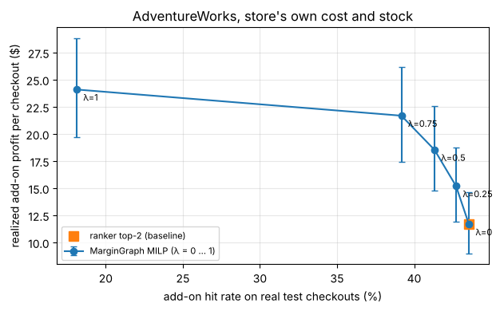

# MarginGraph on a store with its own cost and price (AdventureWorks)

**Question.** Online Retail II has prices but no unit cost and no stock, so until now every Stage 2 profit number used a *simulated* cost. Does MarginGraph still earn more profit than the plain ranker when the cost and stock come from the store's own books?

**Data.** Microsoft's AdventureWorks sample database (a bike and gear shop, MIT licence). It is a **sample company, not a real shop**, but it is the only free dataset we found that has, in one place:

* shopping baskets (sales orders with several lines) and customer ids,
* the price each shopper paid on every line,
* a unit cost for every product (`StandardCost`, plus a dated cost history), and
* an inventory count for every product.

We use the **27,659 online orders** (shoppers at checkout, the add-on task). The time split is the usual 70 / 85 cut: train up to 2025-02-12, validation to 2025-04-14, test 2025-04-15 to 2025-06-29.

**Steps** (each printed as it runs):
1. Download the CSVs from Microsoft's GitHub release and check the file hash.
2. `scripts/public_datasets.py convert adventureworks`: orders and products with `cost` and `stock`.
3. `margingraph sync csv` then `margingraph run` (E1 to E11). Because the products carry cost and stock, Stage 2 uses the store ERP (`erp_store.csv`), not the simulated one.
4. `python -m margingraph.sim`: the 30-day store simulation on the same cost and stock.


```python
import os, sys, json, subprocess, time, resource, hashlib, zipfile, shutil, urllib.request
from pathlib import Path

BRANCH = "main"
if Path("../scripts/public_datasets.py").exists():   # opened from notebooks/ inside the repo
    os.chdir("..")
if not Path("scripts/public_datasets.py").exists():   # Kaggle / Colab: clone first
    if not Path("MarginGraph").exists():
        subprocess.run(["git", "clone", "-q", "--depth", "1", "--branch", BRANCH,
                        "https://github.com/Sanskar1724/MarginGraph.git"], check=True)
    os.chdir("MarginGraph")
    subprocess.run([sys.executable, "-m", "pip", "install", "-q", "-e", "."], check=True)
ROOT = Path.cwd()
print("repo:", ROOT)
```

    repo: /home/user/margingraph


## 0. Which datasets have real cost and price?

We searched Kaggle, UCI, Zenodo, Microsoft's sample databases, open-government data and academic retail panels. Ranked by how well they fit MarginGraph (baskets + customers + cost + price + stock):

| Rank | Dataset | Real shop? | Baskets + customers | Price | Cost | Stock | Can we use it here? |
| --- | --- | --- | --- | --- | --- | --- | --- |
| 1 | **AdventureWorks** (Microsoft sample, bikes and gear) | No, sample company | Yes: 27.7k online orders, 18.5k customers, 130 products | Yes, per line | **Yes**, `StandardCost` + dated history | **Yes**, per location | **Yes** (GitHub release, plain CSV). Used below |
| 2 | Wide World Importers (Microsoft sample, wholesaler) | No, sample company | Yes: ~70k invoices, 663 business customers, 227 items | Yes | Yes (`LineProfit`, `LastCostPrice`) | Yes (`StockItemHoldings`) | Only as a SQL Server backup; needs SQL Server to export. Next candidate |
| 3 | Ta Feng (Taiwan grocery) | **Yes** | Yes (customer-day baskets) | Yes | Maybe: `ASSET` column, meaning undocumented | No | Already run in PR #17 (`results/public/tafeng_asset_cost`) |
| 4 | Dominick's Finer Foods (Chicago grocer, Kilts Center) | **Yes** | **No**: weekly store totals only | Yes | Yes, gross margin per product-week | No | Good for checking margins, not for basket add-ons; site blocked from the container |
| 5 | Superstore / Global Superstore (Tableau sample) | No | Small baskets (~2 lines) | Yes | Yes (`Profit` per line) | No | Kaggle only (blocked here); weaker than #1 |
| 6 | Iowa Liquor Sales (state open data) | **Yes** | Store orders (stores as customers) | Yes | Yes (`State Bottle Cost`) | No | Markup is a fixed ~50% by law, so margins barely differ and the optimiser has nothing to choose |
| 7 | Contoso (Microsoft sample) | No | Yes (online sales) | Yes | Yes | Yes | Very large, SQL Server backup only |

**Honest bottom line:** no free dataset of a *real* shop has baskets **and** documented per-item cost. The real-shop ones either lack baskets (Dominick's, Iowa) or have an undocumented cost column (Ta Feng). AdventureWorks is the best fit we can actually run: its cost and stock are the company's own books, but the company is a sample. Real cost still needs a pilot store.

## 1. Get the data


```python
RAW = Path("data/public/adventureworks")
URL = "https://github.com/Microsoft/sql-server-samples/releases/download/adventureworks/AdventureWorks-oltp-install-script.zip"
SHA = "58962e94ea386ef7cd3d8a08211bfd42a79d9b81bdd68fd4b6b0051de6c5bd42"   # copy used for the results in this PR (2026-11-08)
FILES = ["Product.csv", "ProductCategory.csv", "ProductSubcategory.csv", "ProductCostHistory.csv",
         "ProductInventory.csv", "SalesOrderDetail.csv", "SalesOrderHeader.csv"]
RAW.mkdir(parents=True, exist_ok=True)
z = RAW / "AdventureWorks-oltp-install-script.zip"
if not z.exists():
    urllib.request.urlretrieve(URL, z)
h = hashlib.sha256(z.read_bytes()).hexdigest()
print("sha256", h, "(same copy as the PR)" if h == SHA else "(DIFFERENT copy: Microsoft may have re-dated the sample; numbers can differ)")
with zipfile.ZipFile(z) as f:
    for n in FILES:
        f.extract(n, RAW)
print({n: (RAW / n).stat().st_size for n in FILES})
```

    sha256 58962e94ea386ef7cd3d8a08211bfd42a79d9b81bdd68fd4b6b0051de6c5bd42 (same copy as the PR)
    {'Product.csv': 88536, 'ProductCategory.csv': 290, 'ProductSubcategory.csv': 2799, 'ProductCostHistory.csv': 28978, 'ProductInventory.csv': 81385, 'SalesOrderDetail.csv': 13727911, 'SalesOrderHeader.csv': 7899987}


```python
MG = shutil.which("margingraph") or str(Path(sys.executable).with_name("margingraph"))

def sh(*cmd, tail=25):
    cmd = [MG if c == "margingraph" else str(c) for c in cmd]
    print("$", " ".join(cmd), flush=True)
    t = time.time()
    r = subprocess.run(cmd, capture_output=True, text=True)
    out = [l for l in (r.stdout + r.stderr).strip().splitlines() if "Warning" not in l and "eval_set" not in l]
    print("\n".join(out[-tail:]))
    if r.returncode:
        raise RuntimeError(f"failed ({r.returncode}): {' '.join(cmd)}")
    return time.time() - t
```

## 2. Convert: orders + products with the store's own cost and stock


```python
CONV = RAW / "mg"
sh(sys.executable, "scripts/public_datasets.py", "convert", "adventureworks", "--src", RAW, "--out", CONV,
   "--top-items", 0, "--channel", "online")
```

    $ /usr/local/bin/python3.13 scripts/public_datasets.py convert adventureworks --src data/public/adventureworks --out data/public/adventureworks/mg --top-items 0 --channel online


    {
      "dataset": "adventureworks",
      "order_lines": 60398,
      "orders": 27659,
      "orders_with_2plus_products": 17991,
      "products": 130,
      "customers": 18484,
      "first": "2022-05-30 00:00:00",
      "last": "2025-06-29 00:00:00",
      "has_cost": true,
      "has_stock": true,
      "max_customers": null,
      "top_items": 0
    }


    1.517387866973877


```python
import pandas as pd, numpy as np
pd.set_option("display.width", 200)
prod = pd.read_csv(CONV / "products.csv")
prod["margin"] = (prod.price - prod.cost) / prod.price
print("products:", len(prod), "| with cost:", int(prod.cost.notna().sum()), "| with stock:", int(prod.stock.notna().sum()))
print("gross margin by category (median, min, max):")
print(prod.assign(cat=prod.category.str.split(" / ").str[0]).groupby("cat")
      .agg(products=("product_id", "size"), median_price=("price", "median"),
           median_margin=("margin", "median"), min_margin=("margin", "min"), max_margin=("margin", "max")).round(3))
print("\nshare of products under the 15% margin floor:", round(float((prod.margin < 0.15).mean()), 3))
```

    products: 130 | with cost: 130 | with stock: 130
    gross margin by category (median, min, max):
                 products  median_price  median_margin  min_margin  max_margin
    cat                                                                       
    Accessories        22         24.99          0.626       0.626       0.626
    Bikes              88       1120.49          0.393       0.345       0.475
    Clothing           20         51.99          0.626       0.230       0.626
    
    share of products under the 15% margin floor: 0.0


Margins are real spreads, not a random draw: bikes earn about 40% on a high price, while clothing and accessories earn about 60% on a low price. **Every product is above 15%**, so the fixed 15% floor never removes anything here (unlike Ta Feng, where a quarter of products fell under it). A store-specific floor is therefore not needed for this shop; we still report the bundle-floor variant.

## 3. Run the full pipeline on the store's own cost and stock


```python
STORE, RES, ART = Path("data/store/adventureworks"), Path("results/public/adventureworks_real_cost"), Path("data/artifacts/adventureworks")
sh("margingraph", "sync", "csv", "--orders", CONV / "orders.csv", "--products", CONV / "products.csv", "--out", STORE, tail=8)
secs = sh("margingraph", "--config", STORE / "config.yaml", "run", "--results", RES, "--artifacts", ART, tail=30)
peak = resource.getrusage(resource.RUSAGE_CHILDREN).ru_maxrss / 1e6
shutil.copy(CONV / "convert_stats.json", RES / "convert_stats.json")
(RES / "run_stats.json").write_text(json.dumps({"seconds": round(secs), "peak_children_rss_gb": round(peak, 2)}, indent=2))
print(f"run: {secs:.0f} s, peak RAM {peak:.2f} GB")
print(json.loads((RES / "summary.json").read_text())["erp"])
```

    $ /usr/local/bin/margingraph sync csv --orders data/public/adventureworks/mg/orders.csv --products data/public/adventureworks/mg/products.csv --out data/store/adventureworks


        "orders_with_2plus_products": 17991,
        "days_covered": 1126,
        "cost_coverage": 1.0,
        "stock_coverage": 1.0
      }
    }
    
    next: margingraph --config data/store/adventureworks/config.yaml run
    $ /usr/local/bin/margingraph --config data/store/adventureworks/config.yaml run --results results/public/adventureworks_real_cost --artifacts data/artifacts/adventureworks


    [06:35:28] loading data
    [06:35:28] split: {'train_max_ts': '2025-02-12 00:00:00', 'val_min_ts': '2025-02-13 00:00:00', 'val_max_ts': '2025-04-14 00:00:00', 'test_min_ts': '2025-04-15 00:00:00', 'test_max_ts': '2025-06-29 00:00:00', 'invoice_overlap': 0, 'train_lines': 39761, 'val_lines': 10340, 'test_lines': 10297, 'val_events': 3398, 'test_events': 3357, 'val_target_seen_in_train': 1.0, 'test_target_seen_in_train': 1.0, 'test_target_seen_in_train_or_val': 1.0}
    [06:35:28] E1 audit
    [06:35:30] refitting candidate models on train+val for test
    [06:35:32] E3/E4 candidates for val
    [06:35:41] E3/E4 candidates for test
    [06:35:52] E5 LightGBM reranker
    [06:36:01] Stage 2
    [06:36:01] store ERP: {'source': 'csv', 'cost_from_store_share': 1.0, 'stock_from_store_share': 1.0, 'cost_ratio_assumed': 0.6}
    [06:36:02]   popularity_top2: hit=0.1436 realized=0.3397 expected=0.3421
    [06:36:03]   copurchase_top2: hit=0.3649 realized=2.5522 expected=2.6387
    [06:36:04]   ranker_top2: hit=0.4355 realized=11.6891 expected=14.3562
    [06:36:05]   milp_lam0.0: hit=0.4355 realized=11.6891 expected=14.3562
    [06:36:06]   milp_lam0.25: hit=0.4272 realized=15.2042 expected=19.5304
    [06:36:08]   milp_lam0.5: hit=0.4132 realized=18.5491 expected=26.0859
    [06:36:09]   milp_lam0.75: hit=0.3917 realized=21.6878 expected=31.5851
    [06:36:10]   milp_lam1.0: hit=0.1811 realized=24.0982 expected=39.3719
    [06:36:11]   milp_lam1_w1.0: hit=0.1811 realized=24.0982 expected=39.3719
    [06:36:12]   milp_lam1_w1.25: hit=0.1793 realized=24.1009 expected=39.3696
    [06:36:14]   milp_lam1_w1.5: hit=0.1790 realized=24.0968 expected=39.3683
    [06:36:15]   milp_lam1_w2.0: hit=0.1746 realized=24.0638 expected=39.3599
    [06:36:16]   milp_lam1_bundlefloor: hit=0.1811 realized=24.0982 expected=39.3719
    [06:36:18]   milp_lam1_discounts: hit=0.1811 realized=24.0982 expected=39.3719
    [06:36:20] E9 solver agreement check
    [06:36:22] E10 inventory simulation
    [06:37:49] E11 ERP sensitivity
    [06:37:57] done
    run: 151 s, peak RAM 1.04 GB
    {'source': 'csv', 'cost_from_store_share': 1.0, 'stock_from_store_share': 1.0, 'cost_ratio_assumed': 0.6}


### Stage 1: does the ranker beat the best simple method?


```python
from IPython.display import Markdown, display
display(Markdown(subprocess.run([sys.executable, "scripts/public_datasets.py", "compare", "results", str(RES)],
                                capture_output=True, text=True, check=True).stdout))
a = json.loads((RES / "e1_audit.json").read_text())
print("median basket:", a["baskets"]["median_basket_items"], "| share 2+ items:", round(a["baskets"]["share_baskets_2plus"], 3),
      "| co-purchase lift vs shuffled:", round(a["copurchase_vs_shuffled_on_val"]["lift_hit@10_vs_shuffled"], 2))
```


| Results | Test events | Pool recall | Best baseline (picked on val) | Baseline Hit@10 | LightGBM Hit@10 | Diff [95% CI] | Verdict |
| --- | --- | --- | --- | --- | --- | --- | --- |
| `results` | 4480 | 65.3% | ease | 31.1% | 38.1% | +7.0 [+6.0, +8.0] | LightGBM wins |
| `results/public/adventureworks_real_cost` | 3357 | 100.0% | ease | 75.4% | 80.8% | +5.4 [+4.4, +6.4] | LightGBM wins |


    median basket: 2.0 | share 2+ items: 0.582 | co-purchase lift vs shuffled: 1.44


Hit rates are high (80.8% Hit@10) because the shop sells only 130 products and the pool covers all of them; the useful number is the **gap** over the best baseline (EASE), +5.4 points with a 95% CI that stays above zero.

### Stage 2: profit per checkout with the store's own cost


```python
s = pd.read_csv(RES / "e8_strategies_store_erp.csv")
base = s.set_index("strategy").loc["ranker_top2"]
keep = ["popularity_top2", "copurchase_top2", "ranker_top2", "milp_lam0.25", "milp_lam0.5", "milp_lam0.75",
        "milp_lam1.0", "milp_lam1_bundlefloor", "milp_lam1_w2.0"]
t = s.set_index("strategy").loc[keep, ["hit", "realized_profit", "realized_profit_lo", "realized_profit_hi", "violations"]].copy()
t["profit_vs_ranker_%"] = 100 * (t.realized_profit / base.realized_profit - 1)
t["hit"] = 100 * t.hit
t.round(2)
```


<div>
<style scoped>
    .dataframe tbody tr th:only-of-type {
        vertical-align: middle;
    }

    .dataframe tbody tr th {
        vertical-align: top;
    }

    .dataframe thead th {
        text-align: right;
    }
</style>
<table border="1" class="dataframe">
  <thead>
    <tr style="text-align: right;">
      <th></th>
      <th>hit</th>
      <th>realized_profit</th>
      <th>realized_profit_lo</th>
      <th>realized_profit_hi</th>
      <th>violations</th>
      <th>profit_vs_ranker_%</th>
    </tr>
    <tr>
      <th>strategy</th>
      <th></th>
      <th></th>
      <th></th>
      <th></th>
      <th></th>
      <th></th>
    </tr>
  </thead>
  <tbody>
    <tr>
      <th>popularity_top2</th>
      <td>14.36</td>
      <td>0.34</td>
      <td>0.31</td>
      <td>0.37</td>
      <td>0.0</td>
      <td>-97.09</td>
    </tr>
    <tr>
      <th>copurchase_top2</th>
      <td>36.49</td>
      <td>2.55</td>
      <td>2.25</td>
      <td>2.91</td>
      <td>0.0</td>
      <td>-78.17</td>
    </tr>
    <tr>
      <th>ranker_top2</th>
      <td>43.55</td>
      <td>11.69</td>
      <td>9.01</td>
      <td>14.67</td>
      <td>0.0</td>
      <td>0.00</td>
    </tr>
    <tr>
      <th>milp_lam0.25</th>
      <td>42.72</td>
      <td>15.20</td>
      <td>11.93</td>
      <td>18.76</td>
      <td>0.0</td>
      <td>30.07</td>
    </tr>
    <tr>
      <th>milp_lam0.5</th>
      <td>41.32</td>
      <td>18.55</td>
      <td>14.82</td>
      <td>22.60</td>
      <td>0.0</td>
      <td>58.69</td>
    </tr>
    <tr>
      <th>milp_lam0.75</th>
      <td>39.17</td>
      <td>21.69</td>
      <td>17.43</td>
      <td>26.15</td>
      <td>0.0</td>
      <td>85.54</td>
    </tr>
    <tr>
      <th>milp_lam1.0</th>
      <td>18.11</td>
      <td>24.10</td>
      <td>19.71</td>
      <td>28.82</td>
      <td>0.0</td>
      <td>106.16</td>
    </tr>
    <tr>
      <th>milp_lam1_bundlefloor</th>
      <td>18.11</td>
      <td>24.10</td>
      <td>19.71</td>
      <td>28.82</td>
      <td>0.0</td>
      <td>106.16</td>
    </tr>
    <tr>
      <th>milp_lam1_w2.0</th>
      <td>17.46</td>
      <td>24.06</td>
      <td>19.69</td>
      <td>28.78</td>
      <td>0.0</td>
      <td>105.86</td>
    </tr>
  </tbody>
</table>
</div>


```python
pr = pd.read_csv(RES / "e8_paired_vs_ranker_top2.csv")
pr = pr[pr.a.isin(["milp_lam0.25", "milp_lam0.5", "milp_lam0.75", "milp_lam1.0"]) & pr.metric.isin(["hit", "realized_profit"])]
pr.assign(diff=pr["diff"].round(3), ci=pr.apply(lambda r: f"[{r.ci_low:+.3f}, {r.ci_high:+.3f}]", axis=1))[["a", "metric", "diff", "ci"]]
```


<div>
<style scoped>
    .dataframe tbody tr th:only-of-type {
        vertical-align: middle;
    }

    .dataframe tbody tr th {
        vertical-align: top;
    }

    .dataframe thead th {
        text-align: right;
    }
</style>
<table border="1" class="dataframe">
  <thead>
    <tr style="text-align: right;">
      <th></th>
      <th>a</th>
      <th>metric</th>
      <th>diff</th>
      <th>ci</th>
    </tr>
  </thead>
  <tbody>
    <tr>
      <th>9</th>
      <td>milp_lam0.25</td>
      <td>hit</td>
      <td>-0.008</td>
      <td>[-0.016, -0.001]</td>
    </tr>
    <tr>
      <th>10</th>
      <td>milp_lam0.25</td>
      <td>realized_profit</td>
      <td>3.515</td>
      <td>[+0.322, +6.664]</td>
    </tr>
    <tr>
      <th>12</th>
      <td>milp_lam0.5</td>
      <td>hit</td>
      <td>-0.022</td>
      <td>[-0.032, -0.014]</td>
    </tr>
    <tr>
      <th>13</th>
      <td>milp_lam0.5</td>
      <td>realized_profit</td>
      <td>6.860</td>
      <td>[+3.275, +10.386]</td>
    </tr>
    <tr>
      <th>15</th>
      <td>milp_lam0.75</td>
      <td>hit</td>
      <td>-0.044</td>
      <td>[-0.055, -0.034]</td>
    </tr>
    <tr>
      <th>16</th>
      <td>milp_lam0.75</td>
      <td>realized_profit</td>
      <td>9.999</td>
      <td>[+5.946, +13.946]</td>
    </tr>
    <tr>
      <th>18</th>
      <td>milp_lam1.0</td>
      <td>hit</td>
      <td>-0.254</td>
      <td>[-0.272, -0.236]</td>
    </tr>
    <tr>
      <th>19</th>
      <td>milp_lam1.0</td>
      <td>realized_profit</td>
      <td>12.409</td>
      <td>[+7.943, +16.686]</td>
    </tr>
  </tbody>
</table>
</div>


```python
import matplotlib.pyplot as plt
lam = s[s.strategy.str.fullmatch(r"milp_lam[0-9.]+")].sort_values("lam")
fig, ax = plt.subplots(figsize=(6.4, 4))
ax.errorbar(100 * lam.hit, lam.realized_profit,
            yerr=[lam.realized_profit - lam.realized_profit_lo, lam.realized_profit_hi - lam.realized_profit], fmt="o-", capsize=3, label="MarginGraph MILP (λ = 0 … 1)")
for _, r in lam.iterrows():
    ax.annotate(f"λ={r.lam:g}", (100 * r.hit, r.realized_profit), textcoords="offset points", xytext=(6, -10), fontsize=8)
ax.plot(100 * base.hit, base.realized_profit, "s", ms=9, label="ranker top-2 (baseline)")
ax.set_xlabel("add-on hit rate on real test checkouts (%)"); ax.set_ylabel("realized add-on profit per checkout ($)")
ax.set_title("AdventureWorks, store's own cost and stock"); ax.legend(fontsize=8); ax.grid(alpha=.3)
fig.tight_layout(); fig.savefig(RES / "fig_frontier.png", dpi=150); plt.show()
```


    

    


### What does each policy actually offer?


```python
from margingraph.optimize import Policy, solve_enum
slates = pd.read_parquet(ART / "test_slates.parquet")
erp = pd.read_csv(RES / "erp_store.csv")
cat_of = prod.set_index(prod.product_id.astype(str)).category.str.split(" / ").str[0]
price, cost = erp.price.to_numpy(float), erp.unit_cost.to_numpy(float)
over, stock = erp.overstock.to_numpy(bool), erp.stock.to_numpy(float)
p_bar = float((price - cost).clip(min=0).mean())
pols = {"ranker_top2": None, "milp_lam0.5": Policy(lam=0.5), "milp_lam1.0": Policy(lam=1.0)}
rows = []
for eid, g in slates.groupby("event_id", sort=False):
    g = g.sort_values("score", ascending=False).head(20)
    idx = g.item_idx.to_numpy()
    for name, pol in pols.items():
        pick = [0, 1] if pol is None else [j for j, _ in solve_enum(g.p.to_numpy(), price[idx], cost[idx], over[idx], stock[idx], pol, p_bar)]
        for j in pick:
            rows.append({"policy": name, "category": cat_of.get(str(g.item.iloc[j]), "?"), "price": price[idx[j]]})
offers = pd.DataFrame(rows)
mix = pd.crosstab(offers.policy, offers.category, normalize="index").mul(100).round(1)
mix["median offer price $"] = offers.groupby("policy").price.median().round(2)
mix
```


<div>
<style scoped>
    .dataframe tbody tr th:only-of-type {
        vertical-align: middle;
    }

    .dataframe tbody tr th {
        vertical-align: top;
    }

    .dataframe thead th {
        text-align: right;
    }
</style>
<table border="1" class="dataframe">
  <thead>
    <tr style="text-align: right;">
      <th>category</th>
      <th>Accessories</th>
      <th>Bikes</th>
      <th>Clothing</th>
      <th>median offer price $</th>
    </tr>
    <tr>
      <th>policy</th>
      <th></th>
      <th></th>
      <th></th>
      <th></th>
    </tr>
  </thead>
  <tbody>
    <tr>
      <th>milp_lam0.5</th>
      <td>70.8</td>
      <td>24.3</td>
      <td>4.9</td>
      <td>24.99</td>
    </tr>
    <tr>
      <th>milp_lam1.0</th>
      <td>33.3</td>
      <td>65.3</td>
      <td>1.3</td>
      <td>1700.99</td>
    </tr>
    <tr>
      <th>ranker_top2</th>
      <td>81.4</td>
      <td>10.7</td>
      <td>7.9</td>
      <td>21.98</td>
    </tr>
  </tbody>
</table>
</div>


This is where the extra profit comes from. The ranker mostly offers cheap, likely items (helmets, bottles, tyres). As λ grows, MarginGraph offers more bikes: they are less likely to be taken, but one accepted bike earns hundreds of dollars. Bikes are 11% of the ranker's offers, 24% at λ = 0.5 (hit rate only 2.2 points lower) and 65% at λ = 1.0, where the hit rate falls from 43.6% to 18.1%.

## 4. 30-day store simulation on the same cost and stock


```python
sh(sys.executable, "-m", "margingraph.sim", "--artifacts", ART, "--results", RES, "--out", RES / "retail_sim", "--days", 30, "--seeds", 5, tail=12)
sim = pd.read_csv(RES / "retail_sim" / "summary.csv")
rb = sim[sim.policy == "ranker_top2"].set_index("mode").profit
sim["profit_vs_ranker_%"] = 100 * (sim.profit / sim["mode"].map(rb) - 1)
sim[["mode", "policy", "profit", "profit_sd", "accepts", "accept_rate", "margin", "floor_breaks", "profit_vs_ranker_%"]].round(3)
```

    $ /usr/local/bin/python3.13 -m margingraph.sim --artifacts data/artifacts/adventureworks --results results/public/adventureworks_real_cost --out results/public/adventureworks_real_cost/retail_sim --days 30 --seeds 5


    ERP: results/public/adventureworks_real_cost/erp_store.csv
          mode                   policy     profit  profit_sd    revenue  accepts  offers  overstock_units  stockout_blocks  floor_breaks  accept_rate  margin
        replay margingraph_bundle_floor  80897.732        NaN 182692.625    608.0  6714.0            576.0             18.0           0.0        0.091   0.443
        replay   margingraph_item_floor  80897.732        NaN 182692.625    608.0  6714.0            576.0             18.0           0.0        0.091   0.443
        replay margingraph_overstock_w2  80782.154        NaN 182507.995    586.0  6714.0            580.0             18.0           0.0        0.087   0.443
        replay              ranker_top2  39240.406        NaN  82917.202   1462.0  6714.0           1019.0             18.0           0.0        0.218   0.473
    stochastic margingraph_bundle_floor 133225.674  17521.995 303987.517    717.8  6714.0            688.4             18.0           0.0        0.107   0.438
    stochastic   margingraph_item_floor 133225.674  17521.995 303987.517    717.8  6714.0            688.4             18.0           0.0        0.107   0.438
    stochastic margingraph_overstock_w2 133213.357  17654.569 304052.567    697.0  6714.0            693.4             18.0           0.0        0.104   0.438
    stochastic              ranker_top2  49503.612   7710.653 107694.350   1515.4  6714.0           1090.6             18.0           0.0        0.226   0.460


<div>
<style scoped>
    .dataframe tbody tr th:only-of-type {
        vertical-align: middle;
    }

    .dataframe tbody tr th {
        vertical-align: top;
    }

    .dataframe thead th {
        text-align: right;
    }
</style>
<table border="1" class="dataframe">
  <thead>
    <tr style="text-align: right;">
      <th></th>
      <th>mode</th>
      <th>policy</th>
      <th>profit</th>
      <th>profit_sd</th>
      <th>accepts</th>
      <th>accept_rate</th>
      <th>margin</th>
      <th>floor_breaks</th>
      <th>profit_vs_ranker_%</th>
    </tr>
  </thead>
  <tbody>
    <tr>
      <th>0</th>
      <td>replay</td>
      <td>margingraph_bundle_floor</td>
      <td>80897.732</td>
      <td>NaN</td>
      <td>608.0</td>
      <td>0.091</td>
      <td>0.443</td>
      <td>0.0</td>
      <td>106.159</td>
    </tr>
    <tr>
      <th>1</th>
      <td>replay</td>
      <td>margingraph_item_floor</td>
      <td>80897.732</td>
      <td>NaN</td>
      <td>608.0</td>
      <td>0.091</td>
      <td>0.443</td>
      <td>0.0</td>
      <td>106.159</td>
    </tr>
    <tr>
      <th>2</th>
      <td>replay</td>
      <td>margingraph_overstock_w2</td>
      <td>80782.154</td>
      <td>NaN</td>
      <td>586.0</td>
      <td>0.087</td>
      <td>0.443</td>
      <td>0.0</td>
      <td>105.865</td>
    </tr>
    <tr>
      <th>3</th>
      <td>replay</td>
      <td>ranker_top2</td>
      <td>39240.406</td>
      <td>NaN</td>
      <td>1462.0</td>
      <td>0.218</td>
      <td>0.473</td>
      <td>0.0</td>
      <td>0.000</td>
    </tr>
    <tr>
      <th>4</th>
      <td>stochastic</td>
      <td>margingraph_bundle_floor</td>
      <td>133225.674</td>
      <td>17521.995</td>
      <td>717.8</td>
      <td>0.107</td>
      <td>0.438</td>
      <td>0.0</td>
      <td>169.123</td>
    </tr>
    <tr>
      <th>5</th>
      <td>stochastic</td>
      <td>margingraph_item_floor</td>
      <td>133225.674</td>
      <td>17521.995</td>
      <td>717.8</td>
      <td>0.107</td>
      <td>0.438</td>
      <td>0.0</td>
      <td>169.123</td>
    </tr>
    <tr>
      <th>6</th>
      <td>stochastic</td>
      <td>margingraph_overstock_w2</td>
      <td>133213.357</td>
      <td>17654.569</td>
      <td>697.0</td>
      <td>0.104</td>
      <td>0.438</td>
      <td>0.0</td>
      <td>169.098</td>
    </tr>
    <tr>
      <th>7</th>
      <td>stochastic</td>
      <td>ranker_top2</td>
      <td>49503.612</td>
      <td>7710.653</td>
      <td>1515.4</td>
      <td>0.226</td>
      <td>0.460</td>
      <td>0.0</td>
      <td>0.000</td>
    </tr>
  </tbody>
</table>
</div>


The simulator runs the strongest MarginGraph setting (λ = 1). Two caveats: (1) most of the gain comes from a few hundred bikes, so the profit is spiky (see `profit_sd`); (2) the inventory is a single snapshot taken after the sales period, and it is large next to online demand (95% of products count as overstock), so the overstock weight has almost nothing to do on this shop.

## 5. Results in simple words


```python
m = s.set_index("strategy")
for k in ["milp_lam0.5", "milp_lam1.0"]:
    r = m.loc[k]
    print(f"{k}: profit ${r.realized_profit:.2f} per checkout vs ${base.realized_profit:.2f} for the ranker "
          f"({100*(r.realized_profit/base.realized_profit-1):+.0f}%), hit rate {100*r.hit:.1f}% vs {100*base.hit:.1f}%")
rp = sim[sim["mode"] == "replay"].set_index("policy")
print(f"30-day replay: MarginGraph ${rp.loc['margingraph_item_floor','profit']:,.0f} vs ranker ${rp.loc['ranker_top2','profit']:,.0f} of add-on profit; floor breaks {int(rp.loc['margingraph_item_floor','floor_breaks'])}")
```

    milp_lam0.5: profit $18.55 per checkout vs $11.69 for the ranker (+59%), hit rate 41.3% vs 43.6%
    milp_lam1.0: profit $24.10 per checkout vs $11.69 for the ranker (+106%), hit rate 18.1% vs 43.6%
    30-day replay: MarginGraph $80,898 vs ranker $39,240 of add-on profit; floor breaks 0

