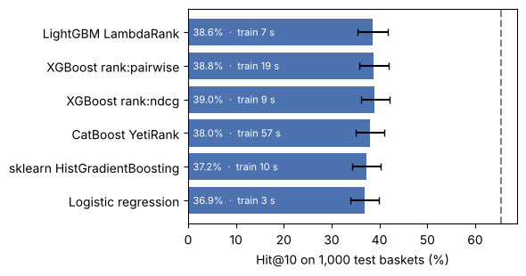

# Reranker comparison on UCI Online Retail II

Is LightGBM LambdaRank the right Stage 1 reranker? This notebook trains five alternatives on exactly the same inputs and scores them on the same test baskets:

* **Same candidates:** the 150-item pool from the 11 retrieval sources (`configs/default.yaml`).
* **Same 35 features**, the same training events (validation invoices, 3 hidden items each, candidates from train-only models) and the same early-stopping slice.
* **Same test baskets:** 1,000 UCI test invoices sampled with seed 42.
* CPU only (4-core cloud container). Confidence intervals: 2,000 bootstrap resamples over test baskets, paired against LightGBM.

The code lives in `scripts/reranker_comparison.py`; this notebook calls it step by step so every output below is from a real run.


```python
import sys, time, platform, os
sys.path.insert(0, '../scripts')
import yaml, numpy as np, pandas as pd
import lightgbm, xgboost, catboost, sklearn
import reranker_comparison as rc

os.chdir('..')  # repository root, so configs/ and data/ resolve
cfg = yaml.safe_load(open('configs/default.yaml'))
print(platform.python_version(), platform.machine(), os.cpu_count(), 'CPUs')
print('lightgbm', lightgbm.__version__, '| xgboost', xgboost.__version__, '| catboost', catboost.__version__, '| sklearn', sklearn.__version__)
print('seed', cfg['seed'], '| pool size', cfg['retrieval']['pool_size'])
```

    3.13.18 x86_64 4 CPUs
    lightgbm 4.7.0 | xgboost 3.4.1 | catboost 1.2.10 | sklearn 1.9.1
    seed 42 | pool size 150


## 1. Candidate pools and features

This is the slow step (about 5 minutes): every retrieval source scores every event.


```python
t0 = time.perf_counter()
feats_val, feats_test = rc.build_features(cfg, n_test=1000)
print(f'built in {time.perf_counter() - t0:.0f} s')
cols = rc.feature_columns(feats_val)
print('features:', len(cols))
print('training rows:', len(feats_val), '| test rows:', len(feats_test), '| test events:', feats_test.event_id.nunique())
in_pool = feats_test.groupby('event_id').label.max()
print(f'pool recall on this sample: {in_pool.mean():.1%} (ceiling for every model)')
```

    /usr/local/lib/python3.13/site-packages/tqdm/auto.py:21: TqdmWarning: IProgress not found. Please update jupyter and ipywidgets. See https://ipywidgets.readthedocs.io/en/stable/user_install.html
      from .autonotebook import tqdm as notebook_tqdm
    /usr/local/lib/python3.13/site-packages/implicit/cpu/als.py:96: RuntimeWarning: OpenBLAS is configured to use 4 threads. It is highly recommended to disable its internal threadpool by setting the environment variable 'OPENBLAS_NUM_THREADS=1' or by calling 'threadpoolctl.threadpool_limits(1, "blas")'. Having OpenBLAS use a threadpool can lead to severe performance issues here.
      check_blas_config()


    [22:15:45] candidates + features for val: 10593 events


    [22:17:48] candidates + features for test: 1000 events


    built in 248 s
    features: 35
    training rows: 1588950 | test rows: 150000 | test events: 1000
    pool recall on this sample: 65.5% (ceiling for every model)


## 2. Train and score the six rerankers


```python
summary, ranks = rc.compare(cfg, feats_val, feats_test, n_boot=cfg['stats']['n_boot'])
out = 'results/reranker_comparison'
os.makedirs(out, exist_ok=True)
summary.to_csv(f'{out}/summary.csv', index=False)
ranks.to_csv(f'{out}/ranks.csv', index=False)
```

    /usr/local/lib/python3.13/site-packages/lightgbm/sklearn.py:1106: LGBMDeprecationWarning: The argument 'eval_set' is deprecated, use 'eval_X' and 'eval_y' instead.
      eval_set = _validate_eval_set_Xy(eval_set=eval_set, eval_X=eval_X, eval_y=eval_y)


    [22:18:16] LightGBM LambdaRank: train 6.7s, score 0.10s, Hit@10 0.386


    [22:18:36] XGBoost rank:pairwise: train 19.4s, score 0.13s, Hit@10 0.388


    [22:18:45] XGBoost rank:ndcg: train 9.4s, score 0.07s, Hit@10 0.390


    [22:19:42] CatBoost YetiRank: train 56.7s, score 0.02s, Hit@10 0.380


    [22:19:52] sklearn HistGradientBoosting: train 10.1s, score 0.20s, Hit@10 0.372


    [22:19:56] Logistic regression: train 3.3s, score 0.04s, Hit@10 0.369


## 3. Results


```python
t = summary.copy()
fmt = lambda x: '' if pd.isna(x) else f'{x:+.1f}'
show = pd.DataFrame({
    'Model': t['model'],
    'Hit@10 %': (100 * t['hit@10']).round(1),
    'Hit@10 95% CI': [f'[{100*a:.1f}, {100*b:.1f}]' for a, b in zip(t['hit@10_ci_low'], t['hit@10_ci_high'])],
    'Hit@2 %': (100 * t['hit@2']).round(1),
    'NDCG@10': t['ndcg@10'].round(3),
    'Train s': t['train_s'].round(0),
    'Score s (1,000 baskets)': t['score_s'].round(2),
    'Δ Hit@10 vs LightGBM': [fmt(100*x) for x in t.get('d_hit@10')],
    'Δ 95% CI': ['' if pd.isna(a) else f'[{100*a:+.1f}, {100*b:+.1f}]' for a, b in zip(t['d_ci_low'], t['d_ci_high'])],
})
show
```


<div>
<style scoped>
    .dataframe tbody tr th:only-of-type {
        vertical-align: middle;
    }

    .dataframe tbody tr th {
        vertical-align: top;
    }

    .dataframe thead th {
        text-align: right;
    }
</style>
<table border="1" class="dataframe">
  <thead>
    <tr style="text-align: right;">
      <th></th>
      <th>Model</th>
      <th>Hit@10 %</th>
      <th>Hit@10 95% CI</th>
      <th>Hit@2 %</th>
      <th>NDCG@10</th>
      <th>Train s</th>
      <th>Score s (1,000 baskets)</th>
      <th>Δ Hit@10 vs LightGBM</th>
      <th>Δ 95% CI</th>
    </tr>
  </thead>
  <tbody>
    <tr>
      <th>0</th>
      <td>LightGBM LambdaRank</td>
      <td>38.6</td>
      <td>[35.5, 41.7]</td>
      <td>17.4</td>
      <td>0.236</td>
      <td>7.0</td>
      <td>0.10</td>
      <td></td>
      <td></td>
    </tr>
    <tr>
      <th>1</th>
      <td>XGBoost rank:pairwise</td>
      <td>38.8</td>
      <td>[35.8, 41.9]</td>
      <td>17.4</td>
      <td>0.234</td>
      <td>19.0</td>
      <td>0.13</td>
      <td>+0.2</td>
      <td>[-1.0, +1.3]</td>
    </tr>
    <tr>
      <th>2</th>
      <td>XGBoost rank:ndcg</td>
      <td>39.0</td>
      <td>[36.1, 42.1]</td>
      <td>17.1</td>
      <td>0.234</td>
      <td>9.0</td>
      <td>0.07</td>
      <td>+0.4</td>
      <td>[-0.6, +1.5]</td>
    </tr>
    <tr>
      <th>3</th>
      <td>CatBoost YetiRank</td>
      <td>38.0</td>
      <td>[35.0, 41.0]</td>
      <td>18.2</td>
      <td>0.239</td>
      <td>57.0</td>
      <td>0.02</td>
      <td>-0.6</td>
      <td>[-2.0, +0.7]</td>
    </tr>
    <tr>
      <th>4</th>
      <td>sklearn HistGradientBoosting</td>
      <td>37.2</td>
      <td>[34.3, 40.2]</td>
      <td>16.0</td>
      <td>0.219</td>
      <td>10.0</td>
      <td>0.20</td>
      <td>-1.4</td>
      <td>[-2.9, +0.1]</td>
    </tr>
    <tr>
      <th>5</th>
      <td>Logistic regression</td>
      <td>36.9</td>
      <td>[34.0, 39.9]</td>
      <td>16.0</td>
      <td>0.221</td>
      <td>3.0</td>
      <td>0.04</td>
      <td>-1.7</td>
      <td>[-3.4, +0.1]</td>
    </tr>
  </tbody>
</table>
</div>


```python
import matplotlib.pyplot as plt
fig, ax = plt.subplots(figsize=(6, 3.2))
ax.barh(t['model'][::-1], 100 * t['hit@10'][::-1], xerr=[100*(t['hit@10']-t['hit@10_ci_low'])[::-1], 100*(t['hit@10_ci_high']-t['hit@10'])[::-1]], color='#4C72B0', capsize=3)
for y, (h, s) in enumerate(zip(100 * t['hit@10'][::-1], t['train_s'][::-1])):
    ax.text(1, y, f'{h:.1f}%  ·  train {s:.0f} s', va='center', color='white', fontsize=8)
ax.axvline(100 * t['pool_recall'].iloc[0], ls='--', color='grey'); ax.set_xlabel('Hit@10 on 1,000 test baskets (%)')
plt.tight_layout(); plt.show()
```


    

    


## Reading

* A model ties LightGBM when its paired Δ interval contains zero; it loses when the whole interval is below zero.
* Every model is capped by pool recall (dashed line): a basket whose hidden item is not in the 150 candidates is a miss for all of them.
* On this 1,000-basket sample LightGBM reaches Hit@10 38.6% (pool recall 65.5%), close to the full 4,480-basket test set (38.1%, pool recall 65.3%). Compare models within this table.
