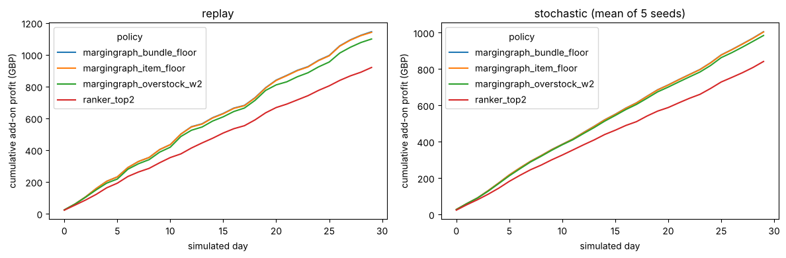

# MarginGraph retail store simulation

This notebook runs MarginGraph inside a simulated store, one day at a time.

**Flow for each checkout:** a shopper arrives with a cart, the candidate pool is built, LightGBM scores p(accept) for the top 20 items, the policy picks up to 2 add-ons, the shopper accepts or rejects, and then stock and profit update.

- Shoppers and carts are **real** Online Retail II test checkouts (Oct to Dec 2011), replayed in time order and split into 30 days.
- Probabilities come from the **real** trained LightGBM ranker.
- Cost, stock and overstock are **simulated**, because the dataset has none. Stock is refilled every 7 days.
- *Replay* means the shopper accepts an add-on only if it is the item they really bought. *Stochastic* means they accept with the calibrated p (5 seeds).

Prerequisite (about 10 minutes on CPU): `margingraph prepare && margingraph run --results ART/results --artifacts ART/artifacts`


```python
import os, pandas as pd, matplotlib.pyplot as plt
from margingraph.sim import POLICIES, run_store
ART = os.environ.get('SIM_ART', '/tmp/claude-0/sim')
slates = pd.read_parquet(f'{ART}/artifacts/test_slates.parquet')
erp = pd.read_csv(f'{ART}/results/erp_simulated.csv')
print(slates['event_id'].nunique(), 'checkouts;', len(erp), 'products;', int(erp['overstock'].sum()), 'overstocked')
print('simulated margin (median):', round(float(((erp.price-erp.unit_cost)/erp.price).median()), 3))
slates.head()
```

    4480 checkouts; 4707 products; 688 overstocked
    simulated margin (median): 0.396


<div>
<style scoped>
    .dataframe tbody tr th:only-of-type {
        vertical-align: middle;
    }

    .dataframe tbody tr th {
        vertical-align: top;
    }

    .dataframe thead th {
        text-align: right;
    }
</style>
<table border="1" class="dataframe">
  <thead>
    <tr style="text-align: right;">
      <th></th>
      <th>event_id</th>
      <th>item_idx</th>
      <th>label</th>
      <th>p</th>
      <th>score</th>
      <th>item</th>
      <th>description</th>
      <th>context</th>
      <th>target</th>
    </tr>
  </thead>
  <tbody>
    <tr>
      <th>0</th>
      <td>0</td>
      <td>474</td>
      <td>0</td>
      <td>0.086705</td>
      <td>1.097314</td>
      <td>21035</td>
      <td>SET/2 RED RETROSPOT TEA TOWELS</td>
      <td>21154</td>
      <td>79321</td>
    </tr>
    <tr>
      <th>1</th>
      <td>0</td>
      <td>273</td>
      <td>0</td>
      <td>0.022067</td>
      <td>0.665048</td>
      <td>20754</td>
      <td>RETROSPOT RED WASHING UP GLOVES</td>
      <td>21154</td>
      <td>79321</td>
    </tr>
    <tr>
      <th>2</th>
      <td>0</td>
      <td>3391</td>
      <td>1</td>
      <td>0.022067</td>
      <td>0.664301</td>
      <td>79321</td>
      <td>CHILLI LIGHTS</td>
      <td>21154</td>
      <td>79321</td>
    </tr>
    <tr>
      <th>3</th>
      <td>0</td>
      <td>561</td>
      <td>0</td>
      <td>0.010753</td>
      <td>0.263911</td>
      <td>21155</td>
      <td>RED RETROSPOT PEG BAG</td>
      <td>21154</td>
      <td>79321</td>
    </tr>
    <tr>
      <th>4</th>
      <td>0</td>
      <td>2090</td>
      <td>0</td>
      <td>0.010483</td>
      <td>0.109500</td>
      <td>22897</td>
      <td>OVEN MITT APPLES DESIGN</td>
      <td>21154</td>
      <td>79321</td>
    </tr>
  </tbody>
</table>
</div>


## One checkout, step by step


```python
from margingraph.optimize import solve_enum
g = slates[slates.event_id == slates.event_id.iloc[0]].reset_index(drop=True)
print('cart:', g['context'].iloc[0][:200])
print('really bought (hidden):', g['target'].iloc[0])
items = g.item_idx.to_numpy(); pr, co = erp.price.to_numpy()[items], erp.unit_cost.to_numpy()[items]
show = g[['item','description','p']].assign(price=pr, cost=co, margin=((pr-co)/pr).round(3), overstock=erp.overstock.to_numpy()[items])
print(show.head(10).to_string())
for name,(kind,pol) in POLICIES.items():
    if kind=='topk': ch=[(0,0.0),(1,0.0)]
    else: ch = solve_enum(g.p.to_numpy(), pr, co, erp.overstock.to_numpy()[items], erp.stock.to_numpy()[items], pol, float((erp.price-erp.unit_cost).clip(lower=0).mean()))
    print(f'{name:26s} ->', [g.description[j] for j,_ in ch])
```

    cart: 21154
    really bought (hidden): 79321
         item                      description         p  price      cost  margin  overstock
    0   21035   SET/2 RED RETROSPOT TEA TOWELS  0.086705   3.25  2.700417   0.169       True
    1   20754  RETROSPOT RED WASHING UP GLOVES  0.022067   2.10  1.727619   0.177      False
    2   79321                    CHILLI LIGHTS  0.022067   4.95  1.777990   0.641      False
    3   21155            RED RETROSPOT PEG BAG  0.010753   2.55  0.925457   0.637      False
    4   22897          OVEN MITT APPLES DESIGN  0.010483   1.45  0.446223   0.692      False
    5   21041  RED RETROSPOT OVEN GLOVE DOUBLE  0.010483   2.95  2.092859   0.291      False
    6   82583             HOT BATHS METAL SIGN  0.010483   2.10  1.339663   0.362      False
    7   22348      TEA BAG PLATE RED RETROSPOT  0.009063   0.85  0.436776   0.486      False
    8   21212  PACK OF 72 RETROSPOT CAKE CASES  0.008610   0.55  0.440320   0.199       True
    9  47559B              TEA TIME OVEN GLOVE  0.007164   1.25  0.773374   0.381      False
    ranker_top2                -> ['SET/2 RED RETROSPOT TEA TOWELS', 'RETROSPOT RED WASHING UP GLOVES']
    margingraph_item_floor     -> ['SET/2 RED RETROSPOT TEA TOWELS', 'CHILLI LIGHTS']
    margingraph_bundle_floor   -> ['SET/2 RED RETROSPOT TEA TOWELS', 'CHILLI LIGHTS']
    margingraph_overstock_w2   -> ['SET/2 RED RETROSPOT TEA TOWELS', 'CHILLI LIGHTS']


## Run the store for 30 days for every policy


```python
runs = []
for pol in POLICIES:
    runs.append(run_store(slates, erp, pol, days=30, seed=None))
    for s in range(5):
        runs.append(run_store(slates, erp, pol, days=30, seed=s))
daily = pd.concat(runs, ignore_index=True)
tot = daily.groupby(['policy','seed']).sum(numeric_only=True).drop(columns='day').reset_index()
tot['mode'] = tot.seed.map(lambda s: 'replay' if s < 0 else 'stochastic')
summ = tot.groupby(['mode','policy'])[['offers','accepts','revenue','cost','profit','overstock_units','stockout_blocks','floor_breaks']].mean()
summ['accept_rate'] = summ.accepts/summ.offers; summ['margin'] = summ.profit/summ.revenue
summ['profit_vs_ranker_%'] = 100*(summ.profit/summ.groupby(level=0).profit.transform(lambda x: x.xs('ranker_top2', level=1).iloc[0]) - 1)
summ.round(3)
```


<div>
<style scoped>
    .dataframe tbody tr th:only-of-type {
        vertical-align: middle;
    }

    .dataframe tbody tr th {
        vertical-align: top;
    }

    .dataframe thead th {
        text-align: right;
    }
</style>
<table border="1" class="dataframe">
  <thead>
    <tr style="text-align: right;">
      <th></th>
      <th></th>
      <th>offers</th>
      <th>accepts</th>
      <th>revenue</th>
      <th>cost</th>
      <th>profit</th>
      <th>overstock_units</th>
      <th>stockout_blocks</th>
      <th>floor_breaks</th>
      <th>accept_rate</th>
      <th>margin</th>
      <th>profit_vs_ranker_%</th>
    </tr>
    <tr>
      <th>mode</th>
      <th>policy</th>
      <th></th>
      <th></th>
      <th></th>
      <th></th>
      <th></th>
      <th></th>
      <th></th>
      <th></th>
      <th></th>
      <th></th>
      <th></th>
    </tr>
  </thead>
  <tbody>
    <tr>
      <th rowspan="4" valign="top">replay</th>
      <th>margingraph_bundle_floor</th>
      <td>8959.0</td>
      <td>671.0</td>
      <td>2588.380</td>
      <td>1443.623</td>
      <td>1144.757</td>
      <td>79.0</td>
      <td>223.0</td>
      <td>21.0</td>
      <td>0.075</td>
      <td>0.442</td>
      <td>24.441</td>
    </tr>
    <tr>
      <th>margingraph_item_floor</th>
      <td>8959.0</td>
      <td>668.0</td>
      <td>2562.300</td>
      <td>1421.178</td>
      <td>1141.122</td>
      <td>78.0</td>
      <td>223.0</td>
      <td>0.0</td>
      <td>0.075</td>
      <td>0.445</td>
      <td>24.046</td>
    </tr>
    <tr>
      <th>margingraph_overstock_w2</th>
      <td>8959.0</td>
      <td>653.0</td>
      <td>2482.940</td>
      <td>1383.895</td>
      <td>1099.045</td>
      <td>116.0</td>
      <td>223.0</td>
      <td>0.0</td>
      <td>0.073</td>
      <td>0.443</td>
      <td>19.472</td>
    </tr>
    <tr>
      <th>ranker_top2</th>
      <td>8959.0</td>
      <td>796.0</td>
      <td>2280.430</td>
      <td>1360.510</td>
      <td>919.920</td>
      <td>114.0</td>
      <td>223.0</td>
      <td>164.0</td>
      <td>0.089</td>
      <td>0.403</td>
      <td>0.000</td>
    </tr>
    <tr>
      <th rowspan="4" valign="top">stochastic</th>
      <th>margingraph_bundle_floor</th>
      <td>8959.0</td>
      <td>678.4</td>
      <td>2302.596</td>
      <td>1297.461</td>
      <td>1005.135</td>
      <td>84.4</td>
      <td>223.2</td>
      <td>21.0</td>
      <td>0.076</td>
      <td>0.437</td>
      <td>19.436</td>
    </tr>
    <tr>
      <th>margingraph_item_floor</th>
      <td>8959.0</td>
      <td>676.8</td>
      <td>2294.180</td>
      <td>1290.386</td>
      <td>1003.794</td>
      <td>84.4</td>
      <td>223.2</td>
      <td>0.0</td>
      <td>0.076</td>
      <td>0.438</td>
      <td>19.276</td>
    </tr>
    <tr>
      <th>margingraph_overstock_w2</th>
      <td>8959.0</td>
      <td>665.4</td>
      <td>2248.032</td>
      <td>1263.493</td>
      <td>984.539</td>
      <td>127.0</td>
      <td>223.0</td>
      <td>0.0</td>
      <td>0.074</td>
      <td>0.438</td>
      <td>16.988</td>
    </tr>
    <tr>
      <th>ranker_top2</th>
      <td>8959.0</td>
      <td>823.4</td>
      <td>2096.484</td>
      <td>1254.915</td>
      <td>841.569</td>
      <td>115.2</td>
      <td>223.0</td>
      <td>164.0</td>
      <td>0.092</td>
      <td>0.401</td>
      <td>0.000</td>
    </tr>
  </tbody>
</table>
</div>


## Cumulative profit over the 30 days (replay acceptance)


```python
fig, ax = plt.subplots(1, 2, figsize=(12, 4))
for i,(mode,sub) in enumerate([('replay', daily[daily.seed<0]), ('stochastic (mean of 5 seeds)', daily[daily.seed>=0])]):
    c = sub.groupby(['policy','day']).profit.mean().groupby(level=0).cumsum().unstack(0)
    c.plot(ax=ax[i]); ax[i].set_title(mode); ax[i].set_xlabel('simulated day'); ax[i].set_ylabel('cumulative add-on profit (GBP)')
plt.tight_layout(); plt.show()
```


    

    


```python
per_day = daily[daily.seed>=0].groupby(['policy','day'])[['accepts','overstock_units','stockout_blocks']].mean().groupby(level=0).sum()
per_day
```


<div>
<style scoped>
    .dataframe tbody tr th:only-of-type {
        vertical-align: middle;
    }

    .dataframe tbody tr th {
        vertical-align: top;
    }

    .dataframe thead th {
        text-align: right;
    }
</style>
<table border="1" class="dataframe">
  <thead>
    <tr style="text-align: right;">
      <th></th>
      <th>accepts</th>
      <th>overstock_units</th>
      <th>stockout_blocks</th>
    </tr>
    <tr>
      <th>policy</th>
      <th></th>
      <th></th>
      <th></th>
    </tr>
  </thead>
  <tbody>
    <tr>
      <th>margingraph_bundle_floor</th>
      <td>678.4</td>
      <td>84.4</td>
      <td>223.2</td>
    </tr>
    <tr>
      <th>margingraph_item_floor</th>
      <td>676.8</td>
      <td>84.4</td>
      <td>223.2</td>
    </tr>
    <tr>
      <th>margingraph_overstock_w2</th>
      <td>665.4</td>
      <td>127.0</td>
      <td>223.0</td>
    </tr>
    <tr>
      <th>ranker_top2</th>
      <td>823.4</td>
      <td>115.2</td>
      <td>223.0</td>
    </tr>
  </tbody>
</table>
</div>


